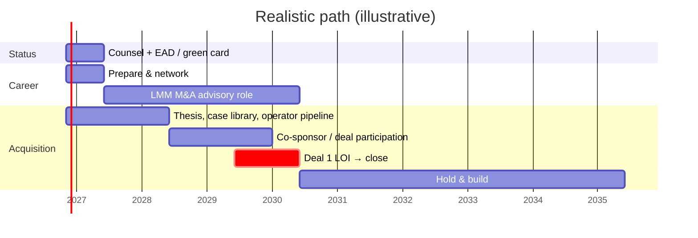

# 01 — Executive Investment Recommendation

**Bagga Holdings · Investment Committee memo · 2026-11-09**
Prepared for: Siddharth Bagga (and spouse) · Status: **CONDITIONAL RECOMMENDATION**

> **Two corrections before anything else**
> 1. **Your degree is M.S. Finance** (UC Lindner) plus the Graduate Certificate in Quantitative Finance — not "MS Financial Mathematics" as the brief says. Your own transcript and diploma were checked in `positioning-system/01-diagnosis.md`. Use the correct title everywhere (R-01).
> 2. **SBA financing is closed to you, now and after your green card.** Since 1-Mar-2026 SBA requires every direct and indirect owner of a 7(a)/504 borrower to be a U.S. citizen or national; green-card holders are excluded too (S-01). Every structure here is non-SBA.

---

## The answer on one page

```text
┌───────────────────────────────────────────────────────────────────────────┐
│ FOCUS INDUSTRY   Commercial fire protection & life safety — inspection-led │
│                  (sprinkler, alarm, extinguisher, kitchen suppression,     │
│                  backflow ITM).  ALTERNATE: commercial pest control.       │
│ WHY              Code-mandated recurring demand · asset-light · a named    │
│                  line of Ohio buyers in 2025-26 · runnable by a strong GM  │
│ FIRST DEAL       Cincinnati MSA · $0.6-1.5m adj. EBITDA · ≥50% ITM         │
│                  revenue · price 4.5-6.0x  →  $2.7m-$9.0m                  │
│ CAPITAL STACK    Senior ≤2.25x · seller note ~16% · rollover ~9% ·         │
│                  investor equity ~34% · YOUR CASH: $0                      │
│ OPERATOR         10+ yr fire & life-safety branch leader, P&L owner,       │
│                  certified, co-invests                                     │
│ CAREER NOW       Prepare → on EAD: LMM sell-side M&A advisory              │
│ REALISTIC TIMING First LOI ≈ 2029-30, NOT in the next 90 days              │
│ BIGGEST RISKS    Immigration missteps · no operator · overpaying with debt │
└───────────────────────────────────────────────────────────────────────────┘
```



---

## 1. Process summary

| Step | What was done | File |
|---|---|---|
| Industry screen | 16 industries × 11 criteria, brief's weights and founder weights, 11-factor risk penalty, two gates | 02 |
| Tie-break | Cincinnati overlay (5 evidenced factors); break-even weight shown (9.6%) | 02 §6 |
| Market research | Top 5 industries, A-L for each; fire deep dive | 03 |
| Case studies | 20 real transactions incl. 7 fire, 6 adjacent, 7 strategy/failure | 04 |
| Model | Live-formula LBO: 4 scenarios, DSCR, IRR/MOIC, waterfall, sensitivity | 06 |
| People, law, career, money | Operator profile; financing & immigration gates; career plan; joint plan | 07, 08, 09, 14 |
| Execution | 90-day calendar, exactly 3 goals a day; tracker; print pack | 10, 11, `print/` |

## 2. Scorecard result

| Rank | Industry | Risk-adjusted | Evidence | Status |
|---:|---|---:|---|---|
| 1 | Pest control (commercial) | 6.32 | Med-High | **Alternate** |
| 2 | **Fire & life safety ITM** | 6.05 | Med-High | **Focus** after overlay (6.83 vs 6.25) |
| 3 | Self-storage | 5.93 | Medium | Rejected — needs real-estate equity |
| 4 | P&C insurance agency | 5.87 | Low | Research list (Week 7) |
| 8 | Commercial HVAC (your preference) | 5.15 | Medium | Rejected for deal #1: cyclicality, technician and project risk |

**The IC's honesty clause:** on the generic scorecard, pest control edges out fire. Fire wins only when Cincinnati-specific evidence is given at least **~10%** weight. We give it 30% because a first-time sponsor's return comes from the exit, and fire has documented Ohio buyers (Summit / Total Life Safety in West Chester, Aug-2025; APi / CertaSite, Feb-2026; and others — S-11, S-14, S-44). **This is re-tested in the field on Days 38-43.** If the field evidence favours pest control, switch.

## 3. Investment Committee conclusion — the 12 answers

**1. Which ONE industry?**
Commercial fire protection & life safety, inspection-led (ITM). Conditional on the Day-45 field test against commercial pest control.

**2. Why is it superior for *this* founder?**
- Demand is required by code: Ohio requires certified companies for ITM work (S-30), and NFPA regimes recur at least annually (S-32).
- It's asset-light (~2% maintenance capex modelled), so it can be financed on cash flow without SBA.
- The inspection → deficiency → repair funnel is measurable. That's where your analytical edge actually moves EBITDA.
- The exit market is local and active (F4, F5, S-44): strategics pay cash.
- It can be run by a strong GM with a licensed operations manager, which fits your role split and your goal of geographic freedom.

**3. The three strongest reasons to reject it**
1. **You'll compete with funded consolidators** — Pye-Barker integrated 57 acquisitions in 2024 (S-13); small firms traded at 4.9x-11.7x (S-21). You may never get a fair price.
2. **Licence and technician dependency.** Ohio/KY credentials sit with individuals (S-30, S-31). The model's downside (−25% EBITDA) drops minimum DSCR to **0.93x**.
3. **Liability tail** — PFAS/AFFF (Kidde-Fenwal: 4,400+ suits, S-12) and life-safety failure exposure.

**4. Ideal first acquisition profile**
Cincinnati MSA (Ohio side first) · revenue $3.5-8m · adjusted EBITDA $0.6-1.5m *after* a market-rate GM · ≥50% inspection/service/monitoring, ≤30% new install · ≥400 active sites, none >10% · certified #2 who stays · retiring owner who'll carry a note and roll 10-15%. (File 03 §B1.)

**5. Realistic purchase price range**
**$2.7m-$9.0m** (4.5-6.0x on $0.6-1.5m). The sweet spot is **$3.5-5.25m** (4.75-5.25x on $0.75-1.0m). Walk away above 6.0x.

**6. Minimum credible capital stack** (Base, $5.75m total uses)
Senior term loan $2.25m (2.25x) · seller note $0.92m (7 yrs, 2 IO) · seller rollover $0.53m · investor cash equity $1.93m · operator co-invest $0.08m · sponsor rolled fee $0.05m · **founder cash $0**. Equity is 45% of sources. Base minimum DSCR is **1.26x**, which passes only barely. Negotiate a third interest-only year or springing standby on the seller note.

**7. Operating partner required**
10+ years in fire & life safety, with 3+ years owning a branch P&L of $3m+ revenue and 15+ technicians. Ohio-certified (NICET a plus) with Cincinnati customer relationships. Co-invests $50-100k for a ~7.5% profits interest vesting over 4-5 years. Most likely sourced from managers at recently acquired local firms. (File 07.)

**8. First region**
Greater Cincinnati, Ohio counties (Hamilton, Butler, Warren, Clermont), then Northern Kentucky (needs KY credentials, S-31), then Dayton → Columbus / Indianapolis / Louisville as tuck-in hubs.

**9. Career to pursue immediately**
Prepare now; on EAD, take a **lower-middle-market sell-side M&A advisory** role in business services / industrials. Second choice: corp dev at a PE-backed services platform *outside* fire protection (to avoid non-compete conflicts). (File 09.)

**10. What must happen before signing an LOI**
All six gates (file 08 §4):
1. **Legal:** written counsel answers on ownership, fees, officer roles and guarantees.
2. **Status:** EAD with 12+ months left, or a green card.
3. **Personal:** 6+ months of household reserves, untouched.
4. **Operator:** signed operator with verified references.
5. **Capital:** 2+ written equity indications and a lender conversation.
6. **Target:** model passes 1.25x Base and 1.0x Downside DSCR.

Plus the IC rules below.

**11. Three biggest risks**
R01 immigration missteps (irreversible) · R02 no operator · R05/R08 overpaying with too much debt. (File 12.)

**12. What to do tomorrow** (Day 1 of the calendar, exactly three goals)

| Goal | Action | Time | Done when |
|---|---|---|---|
| 1 · Career | Change the degree line to "M.S. Finance" everywhere: résumé, LinkedIn, bios | 30 min | Zero occurrences of "Financial Mathematics" remain |
| 2 · Acquisition | Run the two Census CBP queries (file 03 §A2) and open a target sheet with 25 rows (name, city, source URL) from the Ohio SFM certified-company records | 60 min | Sheet exists with ≥25 sourced rows |
| 3 · Network / foundation | Email 3 immigration attorneys (AILA directory) to book a consult; attach `08` §5 questions AQ1-AQ10 | 30 min | 3 emails sent; one consult date requested |

## 4. Scenario snapshot (file 06)

| | Conservative | **Base** | Aggressive | Downside |
|---|---:|---:|---:|---:|
| Price | $3.56m | **$5.25m** | $9.00m | $5.25m |
| Min DSCR | 1.41x | **1.26x** | 1.19x | 0.93x |
| Investor net IRR | 13.8% | **21.9%** | 27.8% | 7.7% |
| Founder pre-tax (5 yrs) | $0.48m | **$1.61m** | $3.53m | $0.52m |
| IC gate | PASS | **PASS** | FAIL | FAIL |

## 5. The goals, challenged (file 14)

$3m/yr personal income needs a ~$30m-EBITDA portfolio at 25% ownership; $25m net worth needs ~$22m. One Base deal ≈ $1.6m pre-tax to you. **Neither number is realistic by 33.** Both are plausible targets for **40-45** with 3-5 good deals. Proposed sequence: **safety (26) → platform (30) → freedom (35) → ambition (40-45).**

## 6. What the evidence could not settle

| Gap | Why it matters | How to close it | When |
|---|---|---|---|
| Real Ohio ITM company financials | Every price and margin here is a band, not a fact | Broker conversations; owner conversations post-EAD | Days 31-90+ |
| Local fire-technician labour availability | Decides the management score | 5 operator/tech conversations | Days 38-43 |
| Pest vs fire in Cincinnati specifically | Decides the industry | Field test, 5 conversations each | Days 38-43 |
| Insurance-agency economics | Could displace the alternate | 3-hour primary research | Day 44 + Week 7 |
| Your legal permissions | Decides what you can do at all | Counsel consult | Days 1-21 |
| Which lenders lend to a first-time non-citizen sponsor | Decides the senior debt line | 3 informational bank conversations (after counsel OK) | Days 60-90 |

## 7. IC rules — written before deal #1 (hurdle discipline, X6)

1. Max entry multiple **6.0x** adjusted EBITDA for sub-$1.5m EBITDA.
2. Adjusted EBITDA **must** subtract the owner's replacement cost.
3. Senior leverage ≤ **2.25x**; total debt ≤ **3.25x** at close.
4. Minimum DSCR ≥ **1.25x** Base and ≥ **1.0x** in a −25% EBITDA downside.
5. Investor net IRR ≥ **20%** in Base without multiple expansion beyond +0.5x.
6. No personal guarantee beyond an agreed cap; never larger than liquid net worth.
7. **No deal without a signed operator.**
8. **No action outside written counsel clearance.**
9. Walk away if add-backs exceed 20% of EBITDA without documents.
10. Walk away from any target with unresolved AFFF/PFAS history.

## 8. File map

| File | Purpose |
|---|---|
| 02 | Industry comparison and scorecard |
| 03 | Top-five market research and first acquisition profile |
| 04 | 20 real case studies |
| 05 | Case-study workbook and worked example |
| 06 | Excel model (`model/build_model.py` rebuilds it) |
| 07 | Operating partner profile and 20 interview questions |
| 08 | Financing and immigration gates |
| 09 | Career and networking plan |
| 10 | 90-day calendar, 3 goals a day |
| 11 | Daily tracker, weekly review, dashboard, scorecard, stop-doing list |
| 12 | Risk register |
| 13 | Source register |
| 14 | Joint financial plan |
| `print/BAGGA_PRINT_PACK.pdf` | Flowcharts and checklists to print and post |

*Final principle, restated:* the objective is not the largest business. It is a durable, cash-generating business bought at a defensible price, with a competent operator and a survivable capital structure.
