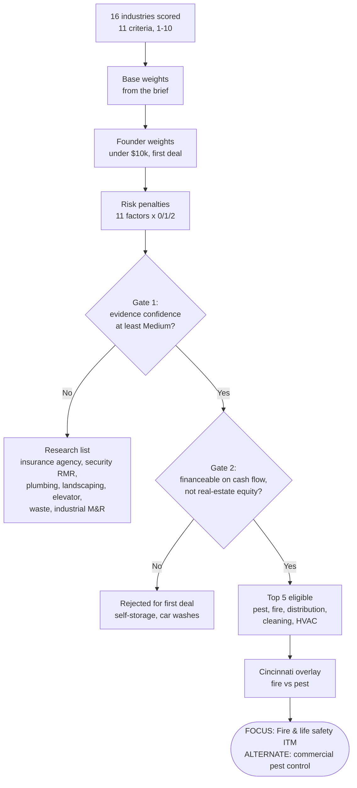

# 02 — Industry Comparison: 16 Industries, Weighted and Risk-Adjusted

**Date:** 2026-11-09 · Sources: `13_SOURCE_REGISTER.md` (S-xx) · Reproduce: `python3 data/score_industries.py` · Live version: `06_FIRST_ACQUISITION_MODEL.xlsx` → *Industry_Scorecard*

---

## 1. The screen in one picture

## 2. Weights

| Criterion | Brief's weight | **Founder weight** | Why it moves for you |
|---|---:|---:|---|
| Recurring revenue & retention | 12% | 12% | Unchanged — the core of debt capacity |
| EBITDA margin & cash conversion | 12% | 12% | Unchanged |
| Fragmentation & availability | 12% | **9%** | Every finalist is fragmented enough; one deal is needed, not fifty |
| Valuation & multiples | 10% | 10% | Unchanged — overpaying is the most common unrecoverable error |
| Capex requirements | 8% | **10%** | No personal capital to fund equipment surprises |
| Operational simplicity | 10% | **12%** | First-time owner; operator must be able to run it without heroics |
| Management hiring & retention | 10% | **12%** | Your model *depends* on a hired operator — this is existential |
| Financing feasibility | 8% | **12%** | SBA is closed to you (S-01); every dollar is investor, bank or seller money |
| Geographic expansion | 7% | **2%** | Irrelevant to deal #1; relevant to deal #4 |
| Customer concentration & resilience | 5% | 5% | Unchanged |
| Founder lifestyle | 6% | **4%** | In years 1-3 lifestyle is set by operator quality and leverage, not by the industry |

## 3. Results

| # | Industry | Base | Founder-wtd | Penalty pts | **Risk-adj.** | Evidence | Gate result |
|---:|---|---:|---:|---:|---:|---|---|
| 1 | Pest control (commercial-led) | 6.97 | 7.02 | 7 | **6.32** | Med-High | ✅ Eligible |
| 2 | **Fire protection & life safety (ITM-led)** | 6.84 | 6.75 | 7 | **6.05** | Med-High | ✅ Eligible |
| 3 | Self-storage | 6.54 | 6.43 | 5 | 5.93 | Medium | ❌ Capital gate |
| 4 | Independent P&C insurance agency | 6.90 | 6.77 | 9 | 5.87 | **Low** | ⚠️ Research list |
| 5 | Security systems & alarm monitoring | 6.51 | 6.41 | 7 | 5.71 | Low-Med | ⚠️ Research list |
| 6 | Specialty distribution | 6.07 | 6.06 | 7 | 5.36 | Medium | ✅ Eligible |
| 7 | Commercial cleaning / janitorial | 6.19 | 6.13 | 8 | 5.33 | Medium | ✅ Eligible |
| 8 | Commercial HVAC / mechanical service | 6.35 | 6.25 | 11 | 5.15 | Medium | ✅ Eligible |
| 9 | Plumbing (commercial service) | 5.83 | 5.77 | 9 | 4.87 | Low-Med | ⚠️ |
| 10 | Commercial landscaping & snow | 5.84 | 5.71 | 9 | 4.81 | Low-Med | ⚠️ |
| 11 | Elevator maintenance (independent) | 5.48 | 5.54 | 8 | 4.74 | Low-Med | ⚠️ |
| 12 | Car washes (express) | 5.65 | 5.54 | 9 | 4.64 | Medium | ❌ Capital gate |
| 13 | Commercial facility management | 5.41 | 5.39 | 8 | 4.59 | Medium | ✅ (low rank) |
| 14 | Electrical contracting (service-led) | 5.45 | 5.35 | 11 | 4.25 | Medium | ✅ (low rank) |
| 15 | Waste collection / roll-off | 5.47 | 5.44 | 12 | 4.24 | Low-Med | ⚠️ |
| 16 | Industrial maintenance & repair | 5.45 | 5.40 | 12 | 4.20 | Low-Med | ⚠️ |

**Risk-adjusted = founder-weighted − 0.1 × penalty points.** The 0.1 factor is a judgment call: it means a severe risk (2 points) costs 0.2, roughly the gap between adjacent ranks.

### Honest reading of the table

1. **The founder weights barely changed the order.** That is useful: the ranking is not an artefact of the weights.
2. **Pest control beats fire protection on the generic scorecard (6.32 vs 6.05).** The margin is inside the noise of 1-10 judgment scores. Section 6 shows what breaks the tie and how much weight it needs.
3. **HVAC — your preliminary preference — ranks 8th.** It loses on penalties: project/construction cyclicality, technician dependence, WIP and bonding complexity, and emergency-call lifestyle. HVAC *service* inside a fire/mechanical platform remains a later add-on idea.
4. **Insurance agency scored 4th on paper using low-quality data.** It is the most important open question in this file (see §7).

---

## 4. Penalty framework (risk adjustment)

Each scored 0 (none), 1 (moderate), 2 (severe).

| Industry | Conc. | Employee dep. | Licensing | Equipment | Working cap. | Regulatory | Cyclicality | Environmental | Margin instab. | Owner dep. | High multiple | **Total** |
|---|---|---|---|---|---|---|---|---|---|---|---|---:|
| Fire & life safety | 0 | 1 | 1 | 0 | 0 | 1 | 0 | 1 | 0 | 1 | 2 | **7** |
| Pest control | 0 | 1 | 1 | 0 | 0 | 1 | 0 | 1 | 0 | 1 | 2 | **7** |
| Commercial HVAC | 1 | 2 | 1 | 1 | 1 | 1 | 1 | 0 | 1 | 1 | 1 | **11** |
| Specialty distribution | 1 | 1 | 0 | 0 | 2 | 0 | 1 | 0 | 1 | 1 | 0 | **7** |
| Commercial cleaning | 2 | 2 | 0 | 0 | 0 | 1 | 1 | 0 | 1 | 1 | 0 | **8** |
| Self-storage | 0 | 0 | 0 | 1 | 0 | 0 | 1 | 0 | 1 | 0 | 2 | **5** |
| Insurance agency | 1 | 1 | 1 | 0 | 0 | 1 | 0 | 0 | 1 | 2 | 2 | **9** |
| Car washes | 0 | 1 | 0 | 2 | 0 | 1 | 1 | 1 | 2 | 0 | 1 | **9** |
| Waste / roll-off | 1 | 1 | 1 | 2 | 0 | 2 | 1 | 2 | 0 | 1 | 1 | **12** |

(Full 16-row matrix in `data/industry_scores.csv`.)

**Why fire and pest both take a 2 on "high multiple":** consolidators are buying aggressively — Pye-Barker integrated **57 acquisitions in 2024** (S-13), APi did **14 in 2025** (S-10), Rollins **26 in 2025** (S-17). You will bid against them.

---

## 5. Every score, explained

Format: **scores** R/M/F/V/C/O/H/Fi/G/Cc/L (recurring, margins, fragmentation, valuation, capex, simplicity, management, financing, geography, concentration, lifestyle) → reasons. "(A)" marks a judgment without a hard source.

### Fire protection & life safety, ITM-led — 9/7/7/4/8/6/5/7/8/8/7
- **R 9** — Ohio requires certified companies for ITM (S-30); NFPA tasks recur weekly→5-yearly, most at least annually (S-32); APi gets ~54% of revenue from inspection, service & monitoring (S-10).
- **M 7** — APi company-wide adj. EBITDA margin 13.2% (S-10) includes project work; Elevated (elevator ITM) ~20% (S-28). Small ITM-heavy firms' margins not verified → capped at 7.
- **F 7** — EVs from $650k to >$20m traded 2018-22 (S-21): small firms exist. Docked because consolidators are absorbing them fast (S-13).
- **V 4** — 4.9x-11.7x EBITDA (S-21); public facilities-services index 15.6x (S-42). Strategic competition is intense.
- **C 8** — Vans, gauges, software (A). No heavy plant.
- **O 6** — Code knowledge, licensing, inspection scheduling, deficiency quoting; more moving parts than pest.
- **H 5** — Certified/NICET technicians are scarce (A, widely reported but not quantified here); licence held by individuals (S-30, S-31).
- **Fi 7** — Asset-light recurring cash flow is bankable (A); deep strategic exit market (§6).
- **G 8** — Every commercial building needs it; national platforms prove portability (S-11, S-13).
- **Cc 8** — Many small building owners/managers; non-discretionary.
- **L 7** — Scheduled inspection routes; fewer 2 a.m. emergencies than HVAC/plumbing (A).

### Pest control, commercial-led — 9/8/7/3/8/7/6/7/6/9/7
- **R 9** — Rollins: ~75% recurring, 10% ancillary, 15% one-time (S-17).
- **M 8** — Rollins adj. EBITDA margin 22.7% (S-17) — the best margin among the public comps reviewed.
- **F 7** — Fragmented at the small end; top end consolidated (Rollins, Rentokil-Terminix) (S-16, S-18).
- **V 3** — Rollins paid ~2.9x revenue for Fox (CALC: $350m / >$120m, S-16); strategics bid hard.
- **C 8** — Trucks, equipment, chemicals (A).
- **O 7** — Route-based, standardised service.
- **H 6** — ODA licence is exam-based, easier to replace than fire certifications (S-43); BLS median pay $44,730 (S-34).
- **Fi 7** — Recurring, asset-light (A).
- **G 6** — Pest pressure and seasonality vary by climate (A — not quantified).
- **Cc 9** — Highly diversified customer base.
- **L 7** — Route work; seasonal peaks.

### Commercial HVAC / mechanical service — 7/6/9/5/7/5/5/7/7/6/5
- **R 7** service agreements, but repair/replacement/project share is large (A) · **M 6** project mix dilutes · **F 9** very large, fragmented contractor base · **V 5** PE demand rising, more supply than fire · **C 7** · **O 5** project bidding, WIP accounting, bonding · **H 5** BLS median $59,810, technician-dependent (S-34) · **Fi 7** · **G 7** · **Cc 6** GC dependence on projects · **L 5** emergency calls and summer peaks. Comfort Systems' growth is project-heavy (S-23).

### Specialty distribution — 6/5/7/6/7/5/6/7/6/5/7
- Repeat purchasing but not contracted (R 6); gross margins carry warehouse/freight costs (M 5, A); Watsco shows buy-and-build works (S-26); inventory & receivables tie up cash (penalty 2 on working capital); supplier line-card risk (Cc 5); business-hours operation (L 7).

### Commercial cleaning — 7/3/9/8/9/5/4/7/7/4/4
- Monthly contracts but short cancellation (A); thin margins — Able (60% engineering/40% janitorial) earned ~5.9% (CALC: $65m/$1.1bn, S-24) (M 3); huge market ~$110bn (S-33) (F 9); cheap multiples (V 8, A); BLS janitor median $35,930 → turnover (H 4, S-34); night-shift no-shows (L 4).

### Commercial facility management (IFM) — 7/3/6/6/9/4/5/5/6/3/5
- Multi-trade subcontract management; ABM/Able economics (S-24) show thin margins; large-customer concentration and re-bid risk.

### Electrical contracting, service-led — 4/5/8/6/7/4/4/6/6/5/5
- Project/construction-cycle exposure (EMCOR-Miller: $755m backlog, S-25); master-electrician licensing; BLS $62,350 (S-34).

### Plumbing, commercial service — 5/6/8/6/7/5/4/6/6/7/4
- Licensed plumbers (BLS $62,970, S-34); emergency-driven; backflow testing is recurring but small.

### Waste collection / roll-off — 6/7/6/5/2/5/6/6/5/6/5
- Trucks and containers are capital-heavy (C 2, A); environmental and regulatory exposure (penalties 2/2); route density is local.

### Self-storage — 6/9/6/2/3/9/8/5/7/9/9
- Midwest Class A trades at 5.15-6.91% cap rates (S-36) → ~14-19x NOI (CALC). Excellent lifestyle and simplicity, but the purchase **is** real estate; needs equity you do not have → **capital gate fail**.

### Car washes, express — 6/7/5/5/3/6/6/4/6/9/6
- Zips: $654m debt, Chapter 11 in Feb-2025, lenders took control (S-19). Multiples 4.3x-7.0x by size (S-35). Equipment and real estate heavy → **capital gate fail**.

### Elevator maintenance, independent — 9/7/3/4/7/4/3/6/5/7/6
- Excellent recurring economics (Elevated ~20% margin, S-28) but few independents and scarce mechanics (F 3, H 3, A).

### Commercial landscaping & snow — 6/5/9/7/5/5/4/6/6/6/4
- Seasonal labour; Ohio snow events are 24/7 (L 4, A).

### Security systems & alarm monitoring (RMR) — 9/6/7/4/6/6/6/6/7/8/7
- Strong recurring revenue, but attrition and DIY/tech disruption risk; evidence gathered in this pass is thin → research list. **Note:** fire alarm monitoring overlaps with the chosen industry — this becomes an add-on, not a separate thesis.

### Independent P&C insurance agency — 9/7/8/4/10/6/5/5/7/7/8
- See §7.

### Industrial maintenance & repair — 5/6/8/6/5/4/5/6/5/4/4
- Tied to manufacturing cycles and a few plant customers (concentration 2, cyclicality 2) (A).

---

## 6. Breaking the fire-vs-pest tie: the Cincinnati overlay

The generic scorecard cannot see local facts. Five founder-specific factors, each scored with evidence (`data/cincinnati_overlay.csv`):

| Factor | Weight | Fire | Pest | Evidence |
|---|---:|---:|---:|---|
| Legal compulsion of demand | 25% | 9 | 6 | Ohio requires certified-company ITM (S-30). Food plants must exclude pests (S-45, verify); residential pest is discretionary. |
| **Named Ohio exit transactions 2025-26** | 25% | 9 | 5 | Fire: Summit / Total Life Safety, **West Chester OH, Aug-2025** (S-14); Alta Protection, Ashland OH, Mar-2025 (S-44); Gardiner / IntelliTech, Medina OH, 2026 (S-44); APi / CertaSite, Midwest, Feb-2026 (S-11). Pest: national tuck-ins proven (S-17), **no Ohio deal sourced**. |
| Local operator talent pool | 20% | 8 | 7 | Fire: Koorsen, Summit, Pye-Barker, APi, Cintas (Mason OH — verify fire division). Pest: Orkin, Terminix branches. |
| Midwest climate independence | 15% | 9 | 6 | Fire demand follows building stock; pest follows climate (A). |
| Measurable founder levers | 15% | 8 | 7 | Inspection → deficiency → repair is a trackable funnel ("inspection-first", S-11). |
| **Overlay score** | | **8.65** | **6.10** | |

**Blend:** Final = (1 − w) × risk-adjusted + w × overlay.

| Overlay weight w | Fire | Pest | Leader |
|---:|---:|---:|---|
| 0% | 6.05 | 6.32 | Pest |
| 10% | 6.31 | 6.30 | Tie |
| 20% | 6.57 | 6.28 | Fire |
| **30% (IC choice)** | **6.83** | **6.25** | **Fire** |

**Break-even overlay weight: 9.6%.** If you believe local, named exit evidence deserves less than ~10% of the decision, pick pest control. The IC gives it 30% because, for a first-time sponsor with no capital, **the exit is where the return is made** — and fire protection has a documented line of Ohio buyers.

> **Decision status: CONDITIONAL.** Fire protection is the focus. Pest control is the alternate. The tie is re-tested in the 90-day plan (Days 38-43) with field evidence: five operator/broker conversations per industry. If pest control wins the field test, switch — before any outreach to sellers.

---

## 7. The insurance-agency question (why it is not the answer — yet)

On paper it scores well: no capex, high renewal revenue, remote-friendly. It is held back because:

1. **Evidence is low quality.** Multiples conflict (3-5x vs 5-8x for small agencies; MarshBerry ~11.5x for brokerages) and retention figures are secondhand (S-37).
2. **Carrier appointments and change-of-control approval** are gatekeepers for an untested 23-year-old buyer (A — to verify with two carriers).
3. **Producer dependency**: the book often follows the producer (owner-dependency penalty 2).
4. **Weak fit with your operator model**: the "operator" is a licensed producer-principal, and your underwriting edge is less differentiating.
5. **The usual small-agency lenders are SBA lenders** (A) — closed to you (S-01).

**Action:** 3 hours of primary research (Day 44 and Week 7). If it survives, it becomes the alternate instead of pest control.

---

## 8. What would change the ranking

| If this turns out true… | Effect |
|---|---|
| Ohio ITM firms trade at 7x+ even below $1m EBITDA | Fire loses its valuation case → pest or distribution |
| Certified fire technicians cannot be hired in Cincinnati within 60 days | Fire's management score falls to 3 → pest wins |
| You become a U.S. citizen (SBA reopens) | Financing scores converge; cleaning and HVAC gain |
| A credible operator partner appears in pest or HVAC first | **Operator quality outranks industry rank.** Re-run with that person's track record. |
