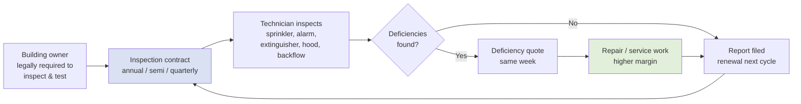
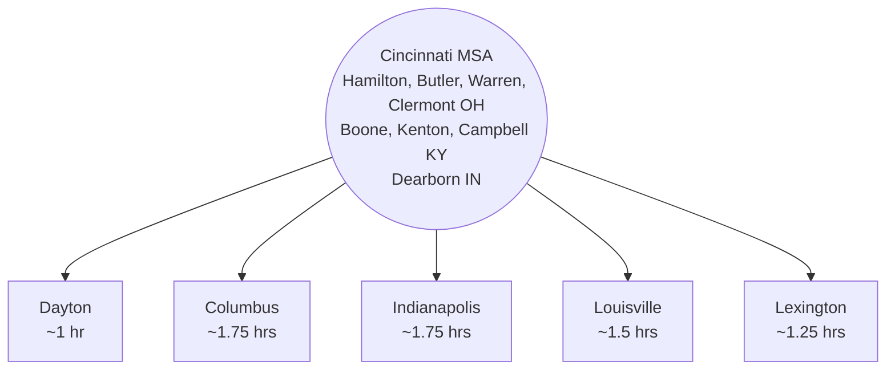
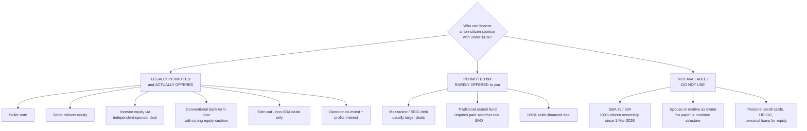

# 03 — Top-Industry Deep Dive & First Acquisition Profile

**Date:** 2026-11-09 · Citations S-xx → `13_SOURCE_REGISTER.md` · (A) = assumption · (CALC) = arithmetic on sourced inputs

Part A covers market research for the five eligible industries (brief §5). Part B is the first acquisition profile and financing scenarios (brief §8), which the Excel model calculates.

---

# PART A — MARKET RESEARCH, TOP FIVE

## A1. The five at a glance

| | **Fire & life safety ITM** | Pest control (commercial) | Specialty distribution | Commercial cleaning | Commercial HVAC service |
|---|---|---|---|---|---|
| **A. US market size** | $22.1bn installation contractors (IBISWorld 2025); $32.5bn fire & life-safety *services* (GMI 2024) — scopes differ (S-33) | $26.1bn (IBISWorld 2025) (S-33) | Not sized in this pass — sub-sector specific | $110.0bn (IBISWorld 2025; another edition $108.9bn) (S-33) | Not sized in this pass |
| **C. Ownership pattern** | Fragmented locals being consolidated: Pye-Barker 57 deals in 2024 (S-13); CertaSite 27 add-ons (S-11) | Two global majors plus thousands of locals; Rollins 26 tuck-ins in 2025 (S-17) | Family distributors; Watsco-style buy-and-build (S-26) | Highly fragmented, low barriers (A) | Very fragmented; Comfort Systems roll-up since 1997 (S-22) |
| **D. Multiples** | 4.9x-11.7x EBITDA, EV $0.65m->$20m (2018-22) (S-21); large deals 12.9x-14.6x (CALC: Elevated, Chubb) | Fox ~2.9x revenue (CALC, S-16) | Not sourced | Able ~12.8x pre-synergy, ~8.3x post (CALC, S-24) — large-cap only | Miller Electric ~10.8x (electrical, CALC, S-25) |
| **E. Margins** | APi 13.2% adj. EBITDA (incl. projects) (S-10); Elevated ITM ~20% (S-28) | Rollins 22.7% (S-17) | Low-to-mid single-digit to low-teens (A) | Able ~5.9% (CALC, S-24) | Project-diluted (A) |
| **F. Labour cost** | Fire-alarm installer pay not retrieved; HVAC proxy $59,810 (S-34) | $44,730 median (S-34) | Warehouse/driver/sales (A) | $35,930 median (S-34) | $59,810 median (S-34) |
| **G. Customer economics** | Annual code-mandated inspections renew; inspections create repair work (A, "inspection-first" S-11) | ~75% recurring (S-17) | Repeat orders, not contracts | Contracts with short cancellation (A) | Maintenance agreements + reactive calls |
| **H. Licensing** | Ohio certified company + certified individuals (S-30); KY firm licence naming certificate holder (S-31) | Ohio ODA applicator + business licence (S-43) | Minimal | Minimal | Ohio OCILB, ~5 yrs experience (S-43) |
| **I. Working capital** | Low-moderate: receivables on inspections/repairs (A) | Low; prepaid plans help (A) | **High** — inventory + receivables | Low; payroll-heavy | Moderate; project WIP |
| **J. Maintenance capex** | ~2% of revenue modelled (A): vans, gauges, software | Trucks, equipment (A) | Fleet, racking (A) | Low | Vans, tools (A) |
| **K. Common failures** | Licence holder leaves; missed inspections → liability; under-priced contracts; slow deficiency quoting | Seasonality; termite-warranty claims (A); tech churn | Supplier line loss; inventory write-downs; margin squeeze | Labour churn; contract losses; margin collapse | Project losses; WIP misstatement; tech poaching |
| **L. Absentee-ownable?** | **Yes with a strong GM + licensed ops manager** | Yes with branch manager | Yes; most systemised | Hardest: night labour supervision | Hard: emergencies, projects |

## A2. Fire & life safety — detail

### What the business actually does



The **inspection** is the recurring, code-mandated annuity. The **repair work it uncovers** is where margin is made. APi explicitly targets a higher share of inspection, service and monitoring revenue (~54% in 2025, targeting 60%) for "higher margins and stability" (S-10). CertaSite was described as "inspection-first" (S-11).

### Service lines (rank by attractiveness for a first deal)

| Service line | Recurring? | Licensing burden | Fit for deal #1 |
|---|---|---|---|
| Fire alarm inspection, testing, monitoring | High | Moderate | ★★★ |
| Sprinkler ITM (NFPA 25) | High | Moderate–high | ★★★ |
| Fire extinguisher service | High, low ticket | Low | ★★ (good tuck-in) |
| Kitchen hood suppression | High (semi-annual, A) | Moderate | ★★ |
| Backflow testing | High (annual, A) | Low–moderate | ★★ |
| New sprinkler installation (construction) | **No** — project | High | ★ avoid >30% of revenue |
| Engineered suppression systems | Mixed | High | ★ |

### Regional geography — Cincinnati first



(Drive times approximate, A.)

**Three-state licensing reality:** a Cincinnati operation serving Northern Kentucky needs Ohio *and* Kentucky credentials (S-30, S-31); Dearborn County needs Indiana's (not researched — gap). A target already licensed in two or three states is worth more to you.

**Counting the targets (reproducible).** No NAICS code isolates fire ITM — sprinkler contractors sit in 238220, alarm firms in 561621, extinguisher service elsewhere. That makes screening hard *for everyone*, which is an advantage for whoever builds the list by hand. Run, then record the result in the CRM:

```text
https://api.census.gov/data/2022/cbp?get=NAME,ESTAB,EMP,PAYANN&for=county:061,017,165,025&in=state:39&NAICS2017=561621
https://api.census.gov/data/2022/cbp?get=NAME,ESTAB,EMP,PAYANN&for=county:015,117,037&in=state:21&NAICS2017=561621
```

Then cross-check against the Ohio State Fire Marshal's certified-company records (S-30) — the closest thing to a complete list of who is legally allowed to do the work. `positioning-system/automation/src/census.py` already pulls CBP data.

### Who buys these companies in Ohio (your eventual exit)

| Buyer | Ohio evidence | Source |
|---|---|---|
| Summit Fire & Security | Bought Total Life Safety, **West Chester OH**, Aug-2025 | S-14 |
| APi Group | Bought CertaSite (Midwest platform with Ohio roots), Feb-2026, ~$90m revenue | S-11 |
| Gardiner Service Co. | Bought IntelliTech, Medina OH, 2026 | S-44 |
| Pye-Barker / Summit | Alta Protection, Ashland OH, Mar-2025 (acquirer conflicting in databases) | S-44 |
| Convergint | A1 Sprinkler, Miamisburg OH (date unconfirmed) | S-44 |

### Expansion path for an internationally mobile holding company

1. **Deal 1:** Cincinnati/NKY ITM platform.
2. **Deals 2-4:** extinguisher, backflow or alarm-monitoring tuck-ins inside a 2-hour radius (Dayton, Columbus, Louisville, Lexington) — shared dispatch, shared licence infrastructure.
3. **Deal 5+:** a second hub (Indianapolis or Columbus) with its own GM.
4. **Holding company layer:** CFO-level reporting, a monthly KPI pack, quarterly board meetings. That is what lets the owner live elsewhere for long stretches.

⚠️ Living abroad for long periods as a green-card holder raises **abandonment-of-residence** and **U.S. tax** questions (S-39). See `08` §6.

---

# PART B — FIRST ACQUISITION PROFILE

## B1. The target — one page

```text
┌──────────────────────────────────────────────────────────────────────┐
│ IDEAL FIRST ACQUISITION — "INSPECTION-FIRST LOCAL FIRE & LIFE SAFETY" │
├──────────────────────────────────────────────────────────────────────┤
│ Location     Cincinnati MSA (OH side first); NKY licence a plus      │
│ Revenue      $3.5m – $8m                                             │
│ Adj. EBITDA  $0.6m – $1.5m AFTER paying a market-rate GM            │
│ Mix          ≥50% inspection/service/monitoring; ≤30% new install     │
│ Customers    ≥400 active sites; none >10% of revenue                 │
│ Team         10–40 employees; certified #2 who will stay             │
│ Licences     Held by someone other than the retiring owner, or a     │
│              documented plan to transfer within 90 days              │
│ Seller       Retiring founder, 60+, wants continuity, will carry a   │
│              note and roll 10–15%                                    │
│ Price        4.5x – 6.0x adjusted EBITDA  →  $3m – $9m               │
│ Red flags    AFFF/foam handling history · one GC = big share of      │
│              revenue · owner is the only certified tech · cash       │
│              revenue not on tax returns · deferred van fleet         │
└──────────────────────────────────────────────────────────────────────┘
```

**Why this size.** Below ~$0.6m adjusted EBITDA the business cannot pay a professional GM *and* service debt. Above ~$1.5m you compete head-on with funded platforms. The Stanford 2026 study's median search-fund deal (~$2.5m EBITDA, ~$16m price, via secondary summaries, S-29) is a useful ceiling: you have less capital and credibility than a funded searcher.

## B2. Realistic purchase price range

| | Low | Mid | High |
|---|---:|---:|---:|
| Adjusted EBITDA | $600k | $1.0m | $1.5m |
| Multiple | 4.5x | 5.25x | 6.0x |
| **Enterprise value** | **$2.7m** | **$5.25m** | **$9.0m** |

Basis: the 4.9x-11.7x range for small fire firms (S-21) and broker indications of 5-7x. **Pay the low end of that range or walk away.** Strategics can pay more because they get synergies you don't.

## B3. Financing options — what is legal vs offered vs theoretical



| Structure | Legally permitted? | Lenders/investors actually offer it to you? | Notes |
|---|---|---|---|
| **SBA 7(a)/504** | **No** — the borrower must be 100% owned by U.S. citizens/nationals (S-01); you are not a citizen; LPRs excluded too | — | Earliest realistic eligibility = after naturalisation. Ask counsel when you would be eligible to naturalise. |
| Conventional bank term loan | Yes (bank KYC/policy varies) | **Sometimes** — needs EBITDA of roughly $750k+, 40-50% equity, guarantees from someone creditworthy (A) | Test with 3 Cincinnati commercial banks in Month 2-3 (informational only) |
| Seller note | Yes | **Yes** — common in small deals (A) | Negotiate interest-only years and standby tied to DSCR |
| Seller rollover equity | Yes | Yes | Keeps the seller helping through transition |
| Independent-sponsor investor equity | Yes — but raising it is a **securities offering** (Reg D; counsel) | **Yes, with a track record**; harder for a first-timer | Survey terms: 2% closing fee, 5% of EBITDA management fee, 15-25% carry (S-07) |
| Earn-out | Yes (prohibited inside SBA deals, S-03) | Yes | Bridges valuation gaps; keep it simple and measurable |
| Operator equity | Yes | Yes | Profits interest, vesting — see `07` |
| Mezzanine / SBIC | Yes | Rare below ~$2m EBITDA (A) | Expensive |
| Traditional search fund | Yes | Unusual at 23 without an MBA (A); searcher salary is **employment** | Revisit post-EAD |
| Spouse as nominal owner | **Do not** | — | Misrepresents ownership to lenders/SBA. Not a workaround. |
| Personal leverage for equity | Legal | — | **Violates your non-negotiables.** No. |

## B4. Three scenarios (from `06_FIRST_ACQUISITION_MODEL.xlsx`)

All non-SBA. Founder brings **$0 cash**; his stake is a rolled closing fee plus a promote.

| | Conservative | **Base** | Aggressive | Downside (Base, −25% EBITDA from Yr 2) |
|---|---:|---:|---:|---:|
| Adjusted EBITDA at close | $750,000 | **$1,000,000** | $1,500,000 | $1,000,000 |
| Entry multiple | 4.75x | **5.25x** | 6.00x | 5.25x |
| Purchase price | $3,562,500 | **$5,250,000** | $9,000,000 | $5,250,000 |
| Total uses (incl. fees, cash) | $3,938,438 | **$5,753,750** | $9,766,875 | $5,753,750 |
| Senior debt | $1,312,500 (1.75x) | **$2,250,000 (2.25x)** | $4,125,000 (2.75x) | $2,250,000 |
| Seller note | $534,375 | **$918,750** | $1,350,000 | $918,750 |
| Seller rollover | $534,375 | **$525,000** | $900,000 | $525,000 |
| Investor cash equity | $1,471,563 | **$1,932,500** | $3,201,875 | $1,932,500 |
| Equity % of sources | 53% | **45%** | 44% | 45% |
| Year-1 DSCR | 1.53x | **1.32x** | 1.19x | 1.32x |
| **Minimum DSCR Yr 1-5** | 1.41x | **1.26x** | **1.19x** | **0.93x** |
| Gross equity MOIC / IRR (5 yrs) | 2.0x / 14.9% | **3.1x / 25.5%** | 4.0x / 32.0% | 1.5x / 8.5% |
| Investor net MOIC / IRR | 1.9x / 13.8% | **2.7x / 21.9%** | 3.4x / 27.8% | 1.5x / 7.7% |
| Founder pre-tax, 5 yrs | $477,866 | **$1,607,801** | $3,530,389 | $515,593 |
| IC gate (min DSCR ≥1.25x; ≥1.0x downside) | PASS | **PASS (barely)** | **FAIL** | **FAIL** |

### What the model is telling you

1. **The Aggressive structure fails.** 2.75x senior leverage can't clear 1.25x DSCR even when everything goes right. Don't chase bigger deals with more debt.
2. **Base passes by 0.01x.** The pinch comes in **Year 3, when the seller note starts amortising**. Fix it in negotiation: three interest-only years, or principal payments that **spring into standby** if DSCR drops below 1.25x.
3. **The Downside breaks the structure (0.93x).** A permanent 25% EBITDA loss (licence holder quits, top techs leave, a big contract goes) means the company can't fully service its debt. Protections: (a) lower senior leverage, (b) a seller note that goes on standby, (c) key-employee retention bonuses at close, (d) a licence-transfer plan as a closing condition.
4. **Founder economics are back-end loaded.** In the Base case ~$1.07m of the $1.61m is promote, earned only at exit. Fees (~$377k over 5 years) are the only near-term cash — and **receiving fees is likely "work" that needs authorisation** (`08`).

### Sensitivity: where the Base structure breaks (Year-3 DSCR)

| EBITDA change ↓ / Senior leverage → | 1.50x | 1.75x | 2.00x | **2.25x** | 2.50x |
|---|---:|---:|---:|---:|---:|
| 0% | 1.57 | 1.45 | 1.34 | **1.25** | 1.17 |
| −10% | 1.41 | 1.29 | 1.20 | 1.12 | 1.05 |
| −20% | 1.24 | 1.14 | 1.06 | 0.99 | 0.92 |
| −30% | 1.08 | 0.99 | 0.92 | 0.86 | 0.80 |

**Rule of thumb from this table:** at 1.75x senior leverage the business survives a 20% EBITDA drop; at 2.25x it survives about 10%.

## B5. Management compensation built into the numbers

| Role | Cash pay (A) | Equity | Where it sits in the model |
|---|---|---|---|
| Operating partner / GM | ~$175k fully loaded (Base) | Co-invest $75k + 7.5% profits interest | Deducted in Adjusted EBITDA ("replacement cost") |
| Founder / sponsor | None from payroll | Rolled closing fee + promote | Management fee 5% of EBITDA |
| Retiring owner | Transition consulting (A) | 10% rollover + seller note | Sources |

**The most common error in small-company LBO models:** counting the owner's salary as an add-back without subtracting what it costs to replace him. This model subtracts it.

## B6. Minimum credible capital stack (Base, ~$5.75m total uses)

```text
 ┌──────────────────────────────┐  $5.75m total uses
 │ Investor cash equity  34%    │  $1.93m  ← family offices / IS capital providers
 ├──────────────────────────────┤
 │ Seller rollover        9%    │  $0.53m
 │ Operator co-invest     1%    │  $0.08m
 │ Sponsor rolled fee     1%    │  $0.05m  ← YOU (no cash)
 ├──────────────────────────────┤
 │ Seller note           16%    │  $0.92m  ← 7 yrs, 2 yrs IO, 6%
 ├──────────────────────────────┤
 │ Senior term loan      39%    │  $2.25m  ← 2.25x EBITDA, 7-yr amort.
 └──────────────────────────────┘
```

**Never recommend a deal because it can be financed.** This one is financeable *only* if diligence confirms the EBITDA, a certified #2 stays, and the seller accepts the note structure.
