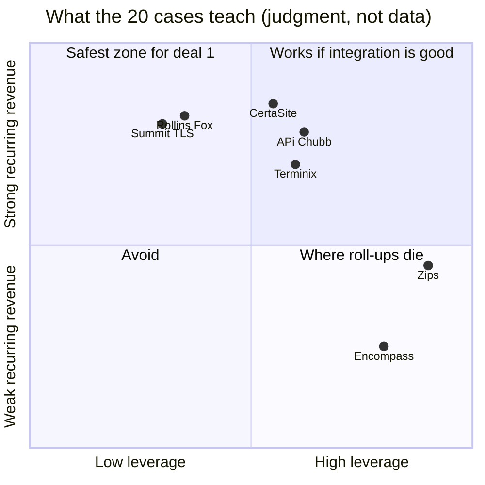

# 04 — Real Acquisition Case Studies (20)

**Date:** 2026-11-09 · Every figure carries a source ID → `13_SOURCE_REGISTER.md`. "n/d" = **not publicly disclosed**. (CALC) = my arithmetic on disclosed figures. Nothing below is estimated where the source is silent.

> **Status warning:** facts were captured from search-result extracts of the cited pages on 2026-11-09 (status SR). Open each link before you repeat a number to an investor or seller.

## At a glance

| # | Deal | Year | Industry | Strategy | Price | Outcome signal |
|---|---|---|---|---|---|---|
| F1 | APi Group ← Chubb Fire & Security | 2021-22 | Fire & security | Strategic carve-out, scale | $3.1bn EV | Integrated; APi 13.2% margin 2025 |
| F2 | J2 Acquisition ← APi Group | 2019 | Fire/safety services | Permanent-capital buyout of ESOP/private company | ~$2.9bn | Became listed consolidator |
| F3 | Riverside builds CertaSite | 2018-25 | Fire & life safety | PE buy-and-build from local firms (incl. Ohio) | n/d | 27 add-ons, sold to strategic |
| F4 | APi ← CertaSite | 2026 | Fire & life safety | Strategic buys a regional platform | n/d (~$90m revenue) | Closed Feb-2026 |
| F5 | Summit Fire & Security ← Total Life Safety | 2025 | Fire & life safety | Local tuck-in, **West Chester OH** | n/d | Closed Aug-2025 |
| F6 | Pye-Barker Fire & Safety program | 2016-25 | Fire & life safety | Serial roll-up + recaps | n/d | 57 deals in 2024 |
| F7 | Agellus ← Bluejack (3-company merger) | 2025 | Fire & life safety | Simultaneous multi-company platform | n/d | Add-ons continuing |
| A1 | Rollins ← Fox Pest Control | 2023 | Pest control | Strategic, earn-out | $350m | Revenue on plan; thin GAAP earnings yr 1 |
| A2 | ABM ← Able Services | 2021 | Facility services | Strategic, synergy-led | $830m | — |
| A3 | EMCOR ← Miller Electric | 2025 | Electrical contracting | Strategic, keep management | $865m | — |
| A4 | Comfort Systems ← Summit Industrial (+ Eldeco) | 2023-24 | Mechanical/electrical | Serial strategic | n/d | — |
| A5 | Watsco "buy and build" | 1989- | HVAC distribution | Keep local brands | various | Long-running program |
| A6 | APi ← Elevated Facility Services | 2024 | Elevator ITM | Strategic adjacency | ~$570m | — |
| X1 | Zips Car Wash | 2025 | Car washes | Debt-funded roll-up | — | **Chapter 11** |
| X2 | Rentokil ← Terminix | 2022-25 | Pest control | Mega-merger | n/d here | **Underperformed**, profit warnings |
| X3 | Encompass Services | 2000-02 | Mechanical/electrical | Roll-up of roll-ups | — | **Chapter 11** |
| X4 | Kidde-Fenwal | 2023 | Fire products | Legacy liability | — | **Chapter 11** |
| X5 | Comfort Systems USA IPO roll-up | 1997 | Commercial HVAC | 12 companies at IPO | — | Survived; now a leader |
| X6 | Constellation Software | ongoing | Vertical software | Decentralised, hold forever | various | Hurdle-rate discipline |
| X7 | Search funds (Stanford 2026) | 1984-2025 | Mixed | Entrepreneurship through acquisition | median ~$16m | 33.9% IRR aggregate; dispersion high |

---

## TOP INDUSTRY — FIRE & LIFE SAFETY

### F1. APi Group ← Chubb Fire & Security (Carrier carve-out)

| Field | Detail |
|---|---|
| 1. Acquirer | APi Group Corporation (NYSE: APG) |
| 2. Target | Chubb fire & security business (from Carrier) |
| 3. Year | Announced 27-Jul-2021; closed ~3-Jan-2022 (S-08) |
| 4. Location | Multi-country business carved out of Carrier; U.S. acquirer |
| 5. Industry | Fire safety & security services |
| 6. Value | **$3.1bn EV** = $2.9bn cash + ~$0.2bn assumed liabilities (S-08) |
| 7. Revenue/EBITDA/multiple | LTM Mar-2021 revenue ~**$2.2bn**, adj. EBITDA ~**$213m** (S-08) → **~14.6x**, ~9.7% margin (CALC) |
| 8. Financing | **$800m** 5.5% perpetual convertible preferred (Blackstone $600m, Viking $200m) + **$1.4bn** term loan + **$400m** senior notes (S-08) |
| 9. Strategic reason | Scale in recurring inspection & service; international platform |
| 10. Operating improvements | Margin expansion and service-mix plan stated; Chubb-specific post-deal results **n/d separately** in this pass |
| 11. Integration | Held as a distinct business within APi's Safety Services |
| 12. Results after | APi company-wide adj. EBITDA margin **13.2%** in 2025 (S-10) — not Chubb-specific |
| 13. Risks | Buying a sub-10%-margin business at ~14.6x relies on improvement; large integration across many countries |
| 14. Done right | Paid in part with equity-like preferred, not just debt; bought what they already knew how to run |
| 15. Could have gone wrong | Margin plan fails → overpaid by several turns of EBITDA |

**Lessons for you:** (1) A low-margin target can be worth more to an operator who knows how to fix it — *but only to that operator.* (2) Mix debt with patient equity. (3) Inspection-and-service revenue is what large buyers pay up for: build toward it. (4) Large buyers paying ~14x is your exit, not your entry. (5) Separate company-level results from deal-level results before claiming a deal "worked".

### F2. J2 Acquisition Limited ← APi Group

| Field | Detail |
|---|---|
| 1-2. Parties | J2 Acquisition Ltd (LSE-listed acquisition vehicle of Martin Franklin, James Lillie, Ian Ashken) ← APi Group, Inc. |
| 3-5. Year / place / industry | Announced 3-Sep-2019, closed 1-Oct-2019; New Brighton, Minnesota; safety & specialty services (S-09) |
| 6. Value | **~$2.9bn** (S-09) |
| 7. Financials | n/d in captured sources |
| 8. Financing | Cash on hand + **$1.2bn** new secured term debt + **48.9m** ordinary shares at $10.25 (S-09) |
| 9. Reason | Permanent public capital to back a founder-built, employee-owned services company |
| 10-11. Improvements / integration | CEO Russ Becker and CFO Tom Lydon kept; Franklin & Lillie became co-chairs; prior holders (mostly the ESOP) kept ~14.5% (S-09) |
| 12. After | APi became an acquirer itself (F1, F4, A6) |
| 13. Risks | Listing a private company on new capital-markets expectations |
| 14. Done right | Kept proven management; sellers kept a stake |
| 15. Could go wrong | Debt plus public-market pressure could have forced short-term decisions |

**Lessons:** (1) Keep the people who built the business — buy the team. (2) Rollover equity aligns sellers. (3) Permanent capital lets a services company compound acquisitions. (4) Investors back **a team with a record**; you need one before you raise a fund. (5) The holding-company model you want is a version of this — at 1/1,000th the scale.

### F3. The Riverside Company builds CertaSite (2018-2025)

| Field | Detail |
|---|---|
| 1-2. Parties | The Riverside Company (PE) → formed CertaSite from multiple local firms |
| 3-5. Year / place / industry | Formed Jun-2018; HQ Indianapolis; early companies included **County Fire Protection (Ohio & Pennsylvania)**, Company One, Approved Protection Systems, Field's Fire Protection, Spears Fire & Safety; 2020: three businesses merged into Advanced Fire; **ABC Fire, Youngstown OH** (2020) (S-11) |
| 6-7. Values | **n/d** |
| 8. Financing | n/d |
| 9. Reason | Fragmented Midwest fire & life safety market; build density |
| 10. Improvements | Leadership from industry: CEO Jeff Wyatt spent 25 years at **Koorsen Fire & Security**, including as President (S-11) |
| 11. Integration | Merged local brands into regional entities (e.g., Advanced Fire) |
| 12. After | **27 add-ons** over ~7 years per Riverside (other databases say 16-18 — CONFLICT); grew to ~$90m revenue, ~250 technicians (S-11) |
| 13. Risks | Integrating many small cultures; technician retention |
| 14. Done right | Hired a CEO who had run a regional fire company — **operator first, deals second** |
| 15. Could go wrong | Too many deals, too little integration (compare X3 Encompass) |

**Lessons:** (1) The operator is the thesis. (2) Ohio fire companies **were** the raw material of a platform later bought by a strategic. (3) Seven years is a realistic hold. (4) Combine brands only once systems work. (5) A local regional leader's former executives are your operating-partner pool.

### F4. APi Group ← CertaSite

| Field | Detail |
|---|---|
| 1-5. | APi Group ← CertaSite (from Riverside); announced 10-Dec-2025, completed **2-Feb-2026**; Midwest; fire & life safety (S-11) |
| 6-7. | Price **n/d**; ~**$90m** expected full-year revenue; ~**250 technicians** (S-11) |
| 8. Financing | **Cash on hand** (S-11) |
| 9. Reason | "Inspection-first" provider; Midwest density |
| 10-12. | n/d (too recent) |
| 13. Risks | Technician retention post-close |
| 14. Done right (seller side) | Riverside built exactly what a strategic wanted: inspection-led, dense, regional |
| 15. Could go wrong | Culture clash; customer churn during rebranding |

**Lessons:** (1) Build the asset the buyer wants — inspection-heavy. (2) Strategics pay with cash, so there's no financing risk at exit. (3) Your exit buyer list already exists. (4) Technician headcount is a disclosed value metric: track yours. (5) Undisclosed price ≠ unknowable: watch APi's 10-Q purchase accounting.

### F5. Summit Fire & Security ← Total Life Safety (Cincinnati area)

| Field | Detail |
|---|---|
| 1-2. | Summit Fire & Security LLC (subsidiary of SFP Holding / Summit Companies) ← Total Life Safety, LLC |
| 3-4. | Effective **12-Aug-2025**; **West Chester Township, OH** (S-14) |
| 5. Industry | Fire alarm, extinguishers, exit/emergency lighting, kitchen suppression, backflow, engineered suppression (S-14) |
| 6-8. | Price, financials, financing **n/d** |
| 9. Reason | "Significantly enhances our capabilities in the greater Cincinnati area" (S-14) |
| 10-12. | n/d |
| 13. Risks | Owner transition (owner Doug Patterson ran it from its 2010-opened West Chester HQ) (S-14) |
| 14. Done right | Bought a multi-service-line local firm = immediate cross-selling |
| 15. Could go wrong | Losing the owner's customer relationships |

**Lessons:** (1) **This is exactly your target profile, and a funded buyer got it first.** Speed and relationships matter. (2) Multi-line service (alarm + extinguisher + suppression + backflow) widens the inspection base. (3) Cincinnati is on consolidators' maps now. (4) Owner-founded in 2010 → sold in ~15 years: many owners are earlier than "retirement age". (5) Ask Summit's local managers (later, as networking) what they look for.

### F6. Pye-Barker Fire & Safety — serial roll-up program

| Field | Detail |
|---|---|
| 1-5. | Pye-Barker (Georgia-founded) and sponsors: Carousel Capital (2016-19, **35 add-ons**), **Leonard Green** majority 2019, **Altas Partners** majority alongside LGP Jun-2021, **ADIA and GIC** minority, closed Jan-2025 (S-13) |
| 6-8. | Valuations **n/d**; equity sponsors as above |
| 9. Reason | National fire, life safety and security density |
| 10-11. | Integrated **57 acquisitions in 2024** across 46 states; 250+ branches / 45 states (S-13) |
| 12. After | Reported to be considering a public listing (S-13, SDM report) |
| 13. Risks | Integration capacity; technician workforce (new capital earmarked for technicians) |
| 14. Done right | Successive recaps let early investors exit while the platform kept buying |
| 15. Could go wrong | 57 deals a year is integration risk at a scale that broke Encompass (X3) |

**Lessons:** (1) This is your toughest competitor for targets. (2) Sellers who want their name and team kept may prefer you. (3) Recaps show how platforms create liquidity without a full sale. (4) Pace is not proof of quality. (5) Learn their acquisition criteria — and target what they skip (very small, single-county, owner wants continuity).

### F7. Agellus Capital ← Bluejack Fire & Life Safety (three-company merger)

| Field | Detail |
|---|---|
| 1-5. | Agellus Capital (Clayton, MO) combined **FirePro Tech (TX), Chase Fire (NY), AAA Fire Protection (CA)** into Bluejack, HQ Houston; announced Feb-2025 (S-15) |
| 6-8. | **n/d** |
| 9. Reason | National fire-life-safety acquisition platform |
| 10-11. | Add-ons: Orcus Fire & Risk (Mar-2025), Phillips Fire & Life Safety (Houston), Crux Consulting (Nebraska, Feb-2026) (S-15) |
| 12-13. | Too early; risk = three founders, three cultures from day one |
| 14. Done right | Created instant scale for lender/investor credibility |
| 15. Could go wrong | No geographic density → limited route synergies |

**Lessons:** (1) A "merger of small firms" is a real structure. (2) Geographic density beats national logos at your size. (3) Independent, lower-middle-market PE is active here. (4) Platforms need a CEO before deal #2. (5) Watch whether non-dense platforms underperform.

---

## ADJACENT INDUSTRIES

### A1. Rollins ← Fox Pest Control

| Field | Detail |
|---|---|
| 1-5. | Rollins, Inc. ← Fox Pest Control (FPC Holdings); closed Apr-2023; U.S. residential/commercial pest control (S-16) |
| 6. Value | **$350m** headline including **$32m** contingent; accounting purchase price **$339.5m** (S-16) |
| 7. Financials | 2022 revenue **>$120m** (S-16) → ~2.9x revenue (CALC); EBITDA n/d |
| 8. Financing | **$305m** borrowed under credit agreement 3-Apr-2023; $302.8m cash at close + contingent consideration valued at $28.0m (S-16) |
| 9. Reason | Fast-growing residential pest brand |
| 10-11. | Brand kept; Rollins' tuck-in model |
| 12. After | Apr-Dec 2023: revenue **$117.8m**, net earnings **$1.6m** (S-16) |
| 13. Risks | Growth dependent on door-to-door sales model (A) |
| 14. Done right | Earn-out tied price to performance |
| 15. Could go wrong | Paying ~3x revenue for growth that slows |

**Lessons:** (1) Earn-outs shift risk back to the seller. (2) GAAP earnings in year 1 can look thin (amortisation, integration) even when revenue arrives — underwrite cash flow. (3) Strategics pay revenue multiples; you can't. (4) Recurring revenue (~75% at Rollins, S-17) is why. (5) Pest control stays the alternate thesis.

### A2. ABM Industries ← Able Services *(also the worked example in file 05)*

| Field | Detail |
|---|---|
| 1-5. | ABM ← Able Services (San Francisco); agreed 25-Aug-2021; facility services (S-24) |
| 6-7. | **$830m cash**; revenue **~$1.1bn**, adj. EBITDA **~$65m** (COVID-normalised) → **12.8x**, 0.75x revenue, 5.9% margin (CALC) |
| 8. Financing | Cash on hand + revolver (S-24) |
| 9-11. | Engineering-heavy mix (~60% engineering, 40% janitorial); **$30-40m** cost synergies expected, mostly year 1 (S-24) |
| 12. After | n/d at deal level |
| 13. Risks | Synergy delivery; janitorial margin pressure |
| 14. Done right | Bought the higher-skill engineering service mix |
| 15. Could go wrong | Without synergies, 12.8x for a 6% margin business is expensive |

**Lessons:** (1) Price is only "cheap" after synergies **you** can deliver: 830 / (65 + 35) ≈ **8.3x** (CALC). (2) Skilled engineering services beat pure janitorial on margin. (3) Normalised EBITDA ("COVID-adjusted") deserves scepticism. (4) Revolver-funded deals need strong corporate cash flow. (5) Facility services is a scale game — not for deal #1.

### A3. EMCOR ← Miller Electric

| Field | Detail |
|---|---|
| 1-5. | EMCOR Group ← Miller Electric (Jacksonville, FL; century-old); announced 14-Jan-2025, closed 3-Feb-2025 (S-25) |
| 6-7. | **$865m cash**; 2024E revenue **~$805m**, adj. EBITDA **~$80m** → ~10.8x (CALC); $755m backlog (S-25) |
| 8. Financing | Cash on hand |
| 9-11. | CEO Henry Brown stays; HQ stays in Jacksonville; joins Electrical Construction segment (S-25) |
| 12-13. | n/d; risk = construction cycle |
| 14. Done right | Keeps local leadership and brand |
| 15. Could go wrong | Backlog margins erode in a downturn |

**Lessons:** (1) Strategics keep local leaders — you should too. (2) Backlog ≠ recurring revenue. (3) Contracting is more cyclical than ITM. (4) Century-old family firms do sell. (5) Advisors (Stephens) run processes — your sourcing must reach owners **before** bankers do.

### A4. Comfort Systems USA ← Summit Industrial Construction (and Eldeco)

| Field | Detail |
|---|---|
| 1-5. | Comfort Systems USA ← Summit Industrial Construction (Houston), expected close Q1-2024; Eldeco (2023) (S-23) |
| 6-7. | Price **n/d**; Summit expected **~$360-400m** annualised revenue, **$30-45m** EBITDA; Eldeco ~$130-140m revenue, $8-9m EBITDA (S-23, confirm with company filings) |
| 8-12. | n/d |
| 13. Risks | Industrial project exposure |
| 14-15. | Serial, disciplined acquirer for 25+ years (X5) / project cycles |

**Lessons:** (1) Mechanical contractors are often bought for project capability, not recurring revenue. (2) EBITDA ranges as wide as $30-45m signal project volatility. (3) That volatility is why HVAC ranked 8th. (4) Service agreements are the part worth owning. (5) Read company 8-Ks yourself for the exact terms.

### A5. Watsco — "buy and build" in HVAC distribution (program, 1989-)

| Field | Detail |
|---|---|
| Strategy | Acquire market-leading distributors, then add products and locations; **encourage acquired companies to keep historical trade names, management teams and sales organisations**, giving founders an exit (S-26) |
| Values | Deal-specific terms in 10-K acquisition notes (not compiled here) |
| Done right | Preserves local relationships that drive distribution sales |
| Could go wrong | Decentralisation without controls |

**Lessons:** (1) Keep the brand customers trust. (2) A founder's "exit with legacy" is a currency you can offer instead of price. (3) Distribution rewards systems (inventory, pricing). (4) Long-duration programs beat one big deal. (5) Distribution remains a credible alternate for a non-technical founder.

### A6. APi Group ← Elevated Facility Services Group

| Field | Detail |
|---|---|
| 1-5. | APi ← Elevated (from L Squared Capital); agreed Apr-2024, completed Jun-2024; elevator & escalator ITM (S-28) |
| 6-7. | **~$570m cash**; ~**$220m** revenue at ~**20%** adj. EBITDA margin; ~12.9x on ~$44m forecast EBITDA (third-party calc) (S-28) |
| 8. Financing | Cash (S-28) |
| 9. Reason | Non-discretionary inspection, service and repair (S-28) |
| 12-15. | n/d / integration of a new trade |

**Lessons:** (1) ITM economics travel across trades: elevator, fire, backflow. (2) ~20% margins are possible in inspection-led niches. (3) Adjacent services = future add-ons. (4) A mid-market PE firm (L Squared) sold to a strategic — the same path your platform could take. (5) "Non-discretionary" is the phrase buyers pay for.

---

## DIFFERENT STRATEGIES & FAILURES

### X1. Zips Car Wash — debt-funded roll-up, Chapter 11 (2025)

| Field | Detail |
|---|---|
| Parties | Zips Car Wash (sponsor: Atlantic Street Capital) |
| Event | Chapter 11 filed **5-Feb-2025**, N.D. Texas (S-19) |
| Debt | ~**$654m** funded debt, ~$1m cash at filing; plan to cut ~**$279m**; $82.5m DIP (S-19) |
| Causes cited | Debt and maturities, macro headwinds, competition, burdensome leases, rising rates (S-19) |
| Actions | Proposed closing 41 sites; ~260 → ~230 locations; site sales (S-19) |
| Outcome | Plan confirmed 18-Apr-2025; emerged 30-Apr-2025; **lenders took ownership**, ~75 cents recovery (S-19) |
| Advocacy claim (one-sided) | Union letter: under the sponsor, Zips bought 95 locations, doubled revenue to $345m and added $300m of preferred (S-19) |

**Lessons:** (1) Debt plus leases plus competition = fragile. (2) Capital-heavy roll-ups need growing cash flow just to stand still. (3) Equity is wiped first. (4) "Recurring" memberships didn't save an over-levered capital structure. (5) **Your non-negotiable "no reckless leverage" is a return-protecting rule, not a lifestyle preference.**

### X2. Rentokil ← Terminix — integration underperformance (2022-2025)

| Field | Detail |
|---|---|
| Event | Sep-2024 profit warning: H2 North America organic growth ~1%, integration disruption, shares −~18%; Oct-2024 further £80m hit; FY2024 adj. PBT −8.1% to £703m with NA organic +1.5%; late-2025 delay of 2-3 months to Terminix benefits; integration to complete by end-2026 (S-18) |
| Deal value | Not confirmed in this pass |
| Causes cited | Branch integration disruption; over-hiring for a peak season that fell short (S-18) |

**Lessons:** (1) Integration can destroy the organic growth you paid for. (2) Even the world's biggest pest company can stumble. (3) Don't merge branches and systems in peak season. (4) Customer-facing changes need slow sequencing. (5) **Disrupted competitors free up technicians and customers** — an opportunity for local operators.

### X3. Encompass Services — the roll-up of roll-ups (2000-2002)

| Field | Detail |
|---|---|
| Formation | Group Maintenance America + Building One Services merged (announced late 1999, closed early 2000) (S-20) |
| Scale | 2001 sales **$1.635bn**; ranked second-largest U.S. electrical contractor (S-20) |
| Failure | Chapter 11 filed **19-Nov-2002** (S.D. Tex.); residential unit sold to Wellspring for **$40m**; mechanical contractors sold piecemeal; many bought back by their original owners; plan confirmed 28-May-2003 (S-20) |
| Causes cited | Multiple factors incl. telecom/datacom exposure (S-20) |

**Lessons:** (1) Buying fast is easy; integrating is hard. (2) Owners who sell can buy back cheaply — a signal the consolidator added little. (3) Cyclical project exposure plus debt kills. (4) Size isn't safety. (5) Every 2020s roll-up should be read against this one.

### X4. Kidde-Fenwal — liability-driven bankruptcy (2023)

| Field | Detail |
|---|---|
| Event | Chapter 11, May-2023, D. Del. No. 23-10638; named in **4,400+** AFFF (firefighting foam) suits; sold AFFF 2007-2013 (S-12) |
| Parent | Carrier (inherited KFI in 2020 spin from UTC) proposed ~**$730m** settlement (Oct-2024); CT and DE attorneys general objected May-2025 (S-12) |

**Lessons:** (1) **PFAS/AFFF is the environmental tail risk in fire protection.** (2) Diligence every site where foam was stored, tested or discharged. (3) Buy assets, not entities, when legacy liability is possible (structuring = counsel). (4) Insurance history matters: get occurrence-based policy records. (5) Indemnities from a seller are worth only what the seller can pay.

### X5. Comfort Systems USA — the 1997 IPO roll-up that survived

| Field | Detail |
|---|---|
| Structure | Formed Dec-1996; IPO **2-Jul-1997** with **12 HVAC companies** acquired simultaneously; 27 acquisitions in 1997, 82 more by end-1998, 107 post-IPO by end-1999 (S-22) |
| Contrast | Encompass (X3) failed in the same era; Comfort Systems survived and is an active acquirer today (A4) |

**Lessons:** (1) Same strategy, different outcomes → **execution and leverage decide.** (2) Goodwill-heavy balance sheets punish mistakes. (3) Slowing down after a burst can save a roll-up. (4) Founding-company owners staying on matters. (5) Start with one company, not twelve.

### X6. Constellation Software — decentralised permanent ownership

| Field | Detail |
|---|---|
| Model | Business units can acquire without HQ approval inside hurdle rates and size limits; "Keep Your Capital" policy (2018); in 2019 the board **lowered the hurdle for acquisitions needing ≥US$100m equity** (S-27) |

**Lessons:** (1) A written hurdle rate is a discipline, not a formality. (2) Decentralise operations, centralise capital allocation. (3) Hold forever avoids transaction costs. (4) Many small deals compound if each clears the bar. (5) Adapt for Bagga Holdings: a written IC rule (file 01 §IC rules) before deal #1.

### X7. Search funds — the strategy benchmark (Stanford GSB 2026)

| Field | Detail |
|---|---|
| Data | 862 funds; **33.9%** aggregate IRR, **4.75x** ROI to 31-Dec-2025; ~58% historically acquire, only **48%** of 2021-24 cohorts; median 2024-25 deal ~$16.0m price, ~$2.5m EBITDA, ~6.2x (secondary) (S-29) |

**Lessons:** (1) Aggregate returns hide wide dispersion. (2) Half of recent searchers haven't bought anything yet. (3) The median deal is bigger than your realistic first deal. (4) Searchers are backed because of credentials and networks you are still building. (5) Being the person who has read the cohort data is a conversational edge (`positioning-system/17` §8).

---

## Cross-case synthesis — the ten rules

1. **Operator first** (F3, F2, A3).
2. **Recurring inspection revenue is the asset** buyers pay for (F1, F4, A6).
3. **Leverage kills before markets do** (X1, X3).
4. **Integrate slowly, especially customer-facing systems** (X2, X3).
5. **Keep the local brand and people** (A3, A5, F2).
6. **Price is only cheap after synergies *you* can deliver** (A2).
7. **Environmental tail risk is real in fire** (X4).
8. **Earn-outs and rollover share risk with the seller** (A1, F2).
9. **Consolidators already shop in Cincinnati** (F5, S-44) → speed and relationships.
10. **A written hurdle rate protects you from yourself** (X6).
