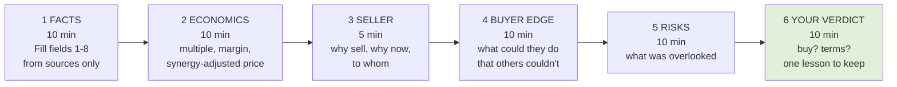

# 05 — Case Study Analysis Workbook

**How to use this:** one case per sitting, 45-60 minutes, scheduled in the 90-day calendar (file 10). Print the one-page card (`print/BAGGA_PRINT_PACK.pdf`, page "Case Study Card") and fill it by hand. Then enter the numbers in `06_FIRST_ACQUISITION_MODEL.xlsx` → *Deal_Template*.

---

## 1. The method: six steps, every time



**Rule:** if a number is not in a source, write **"n/d"**. Never fill a gap with a plausible guess — that habit, practised here, becomes a habit in seller conversations.

## 2. The ten questions (A–J)

| | Question | What a good answer contains |
|---|---|---|
| **A** | What was acquired? | Entity vs assets, service lines, geography, headcount |
| **B** | Why was the seller selling? | Retirement, sponsor fund life, strategic exit, distress — with evidence |
| **C** | What made the business attractive? | Recurring revenue %, margin, density, licences, brand |
| **D** | What were the economics? | EV, revenue, EBITDA, EV/EBITDA, EV/revenue, synergy-adjusted multiple |
| **E** | How was it financed? | Debt / equity / seller paper / earn-out / stock, with amounts |
| **F** | What was the buyer's competitive advantage? | Synergies, cost of capital, operator talent, speed, reputation |
| **G** | What operational improvements were possible? | Pricing, route density, deficiency conversion, procurement, back office |
| **H** | What risks were overlooked? | Integration, key people, liability, leverage, cyclicality |
| **I** | Would **I** have acquired it? | Yes/No + the one number that decides it |
| **J** | What would I have negotiated differently? | Price, structure, earn-out, rollover, reps & warranties, closing conditions |

## 3. Starter answers for all 20 cases (A–H pre-filled from sources; I–J are yours)

| Case | A. Acquired | B. Why sell | C. Attractive | D. Economics | E. Financing | F. Buyer edge | G. Improvements | H. Overlooked risk | I | J |
|---|---|---|---|---|---|---|---|---|---|---|
| F1 APi←Chubb | Chubb fire & security | Carrier portfolio reshaping (A) | Global ITM base | $3.1bn, ~14.6x (CALC) | Pref $800m + $1.8bn debt | Fire-services operator | Margin, mix | Multi-country integration | ☐Y ☐N | |
| F2 J2←APi | Whole company | Liquidity for ESOP/holders (A) | Diversified safety services | ~$2.9bn | $1.2bn debt + shares | Permanent capital | Acquisitions | Public-market pressure | ☐Y ☐N | |
| F3 Riverside→CertaSite | Local fire firms | Owner succession (A) | Fragmented Midwest | n/d | n/d | Industry CEO | Density, mergers | Integration of 27 deals | ☐Y ☐N | |
| F4 APi←CertaSite | Regional platform | PE fund exit (~7-yr hold) | Inspection-first, 250 techs | n/d; ~$90m rev | Cash | Strategic synergies | Cross-sell | Tech retention | ☐Y ☐N | |
| F5 Summit←TLS | West Chester OH firm | n/d | Multi-line local service | n/d | n/d | Platform + capital | Cross-sell | Owner relationships | ☐Y ☐N | |
| F6 Pye-Barker | 57 firms (2024) | Owner exits (A) | National density | n/d | PE + sovereign funds | Capital, pace | Back office | Integration at pace | ☐Y ☐N | |
| F7 Agellus←Bluejack | 3 firms at once | n/d | Platform formation | n/d | n/d | LMM PE capital | Shared systems | No density | ☐Y ☐N | |
| A1 Rollins←Fox | Pest brand | Growth-stage exit (A) | Fast growth | $350m, ~2.9x rev | $305m borrowed + earn-out | Scale | Routing, procurement | Sales-model dependence | ☐Y ☐N | |
| A2 ABM←Able | Facility services co. | n/d | Engineering mix | $830m, 12.8x / 8.3x post-syn. | Cash + revolver | $30-40m synergies | Overhead | Synergy delivery | ☐Y ☐N | |
| A3 EMCOR←Miller | Electrical contractor | n/d | Century-old, $755m backlog | $865m, ~10.8x | Cash | Balance sheet | Procurement | Construction cycle | ☐Y ☐N | |
| A4 CSI←Summit Ind. | Industrial contractor | n/d | Industrial capability | n/d; $30-45m EBITDA | n/d | Serial acquirer | Cross-sell | Project volatility | ☐Y ☐N | |
| A5 Watsco | Distributors | Founder exit w/ legacy | Market leaders | Various | Various | Keep brands | Add products/locations | Weak controls | ☐Y ☐N | |
| A6 APi←Elevated | Elevator ITM | PE exit | ~20% margin ITM | ~$570m, ~12.9x | Cash | Adjacent ITM know-how | Pricing, density | New trade's labour | ☐Y ☐N | |
| X1 Zips | (failure) | — | Memberships | $654m debt | Debt + pref | — | — | Leverage + leases | ☐Y ☐N | |
| X2 Rentokil←Terminix | Terminix | Merger | U.S. scale | n/d here | n/d here | Global scale | Branch merge | Integration disruption | ☐Y ☐N | |
| X3 Encompass | (failure) | — | Scale | $1.635bn sales | Debt | — | — | Integration + cycle | ☐Y ☐N | |
| X4 Kidde-Fenwal | (failure) | — | — | 4,400+ suits | — | — | — | PFAS tail | ☐Y ☐N | |
| X5 Comfort Systems '97 | 12 companies | Founders' liquidity (A) | Fragmented HVAC | n/d here | IPO | Public currency | Shared services | Goodwill | ☐Y ☐N | |
| X6 Constellation | Software firms | Founder exits (A) | Sticky VMS | various | Internal cash | Hurdle discipline | Best practices | Mediocre deals | ☐Y ☐N | |
| X7 Search funds | Small firms | Retirement (A) | Recurring, simple | ~$16m, ~6.2x (sec.) | Debt + investors | Searcher-operator | Professionalise | Searcher inexperience | ☐Y ☐N | |

---

## 4. Worked example — ABM Industries ← Able Services (2021)

All facts from ABM's 8-K Ex-99.1 and 10-Q (S-24). Arithmetic marked CALC.

**A. What was acquired?** Able Services, a San Francisco-headquartered facility services company: ~60% engineering services, ~40% janitorial.

**B. Why was the seller selling?** **n/d** in ABM's disclosure. Don't invent one. *Question to ask in a real deal:* "Why now, and why us?"

**C. What made it attractive?** Scale (~$1.1bn revenue) and an engineering-heavy mix — skilled building engineering earns better margins than janitorial (Able's blended margin was ~5.9%, CALC).

**D. Economics.**

| Line | Value | Working |
|---|---:|---|
| Price | $830m | 8-K |
| Revenue | ~$1,100m | 8-K |
| Adj. EBITDA | ~$65m | 8-K, COVID-normalised |
| EV / EBITDA | **12.8x** | 830 / 65 (CALC) |
| EV / Revenue | 0.75x | 830 / 1,100 (CALC) |
| EBITDA margin | 5.9% | 65 / 1,100 (CALC) |
| Synergies | $30-40m | ABM guidance |
| **EV / (EBITDA + mid synergies)** | **8.3x** | 830 / (65 + 35) (CALC) |

**E. Financing.** Cash on hand plus revolver borrowings. No seller note, no earn-out disclosed.

**F. Buyer's edge.** ABM could remove duplicated overhead (the source of $30-40m synergies). A financial buyer without ABM's platform would pay 12.8x for a 6%-margin business — far riskier.

**G. Improvements.** Overhead consolidation, procurement, cross-selling engineering into ABM accounts (A).

**H. Overlooked risks.** (1) "COVID-normalised" EBITDA embeds a judgment about recovery. (2) Janitorial labour-cost inflation. (3) Synergy timing.

**I. Would I have acquired it?** *Model answer:* As ABM, yes — if I were confident of ≥$30m synergies, because 8.3x post-synergy is reasonable for facility services. As an independent sponsor, **no**: 12.8x pre-synergy on a 5.9% margin leaves no room for error.

**J. What would I have negotiated differently?** *Model answer:* (1) Part of the price as an earn-out tied to EBITDA recovery past the COVID-normalised level. (2) A working-capital peg set on a seasonally adjusted average. (3) Specific indemnity for wage-and-hour claims, common in janitorial (A).

**One lesson to keep:** *Price is only cheap after synergies you can personally deliver.*

---

## 5. Acquisition analysis template

Enter in `06_FIRST_ACQUISITION_MODEL.xlsx` → *Deal_Template* column C, or copy this block:

```text
DEAL: ______________________   DATE: __________   SOURCE(S): ______________________

P&L (LTM, $)                       BALANCE / CASH ($)
Revenue            ____________    Normalised NWC        ____________
Gross profit       ____________    Annual capex          ____________
EBITDA (reported)  ____________    Annual debt service   ____________
 + owner add-backs ____________    DSCR = (EBITDA−capex−tax)/DS = ______x
 − GM replacement  ____________    Free cash flow        ____________
Adjusted EBITDA    ____________

PRICE & STRUCTURE ($)              RETURNS (5-yr)
Enterprise value   ____________    IRR                   ______%
Multiple (EV/Adj.) ______x         MOIC                  ______x
Senior debt        ____________    Downside: EBITDA −25% → DSCR ______x
Seller note        ____________    Downside: exit −1.0x  → MOIC ______x
Equity             ____________
  of which rollover ___________    VERDICT:  ☐ Proceed  ☐ Re-price  ☐ Walk
```

### Definitions (use these exactly)

| Term | Definition used in this project |
|---|---|
| **Adjusted EBITDA** | Reported EBITDA + documented owner/one-time items − market cost to replace the owner's role |
| **Enterprise value (EV)** | Price for the operating business, cash-free / debt-free, before fees |
| **Purchase multiple** | EV ÷ Adjusted EBITDA |
| **Working capital (NWC)** | Receivables + inventory + prepaid − payables − accrued (excluding cash and debt) |
| **DSCR** | (Adj. EBITDA − sponsor fee − maintenance capex − cash taxes) ÷ (interest + scheduled principal) |
| **Free cash flow** | Adj. EBITDA − capex − ΔNWC − cash taxes (− debt service for *levered* FCF) |
| **MOIC** | Equity proceeds at exit ÷ equity invested |
| **IRR** | Annualised return; with no interim distributions, IRR = MOIC^(1/years) − 1 |
| **Downside sensitivity** | Re-run DSCR and MOIC with EBITDA −10/−20/−30% and exit multiple −1.0x |

## 6. Weekly practice rhythm

| Week | Case | Skill drilled |
|---|---|---|
| 1 | A2 ABM ← Able (worked) | Synergy-adjusted multiples |
| 2 | F5 Summit ← TLS | Writing "n/d" with discipline; Cincinnati lens |
| 3 | A1 Rollins ← Fox | Earn-outs |
| 4 | F1 APi ← Chubb | Preferred equity financing |
| 5 | X1 Zips | Leverage failure |
| 6 | F3 + F4 CertaSite | Buy-and-build → exit |
| 7 | X4 Kidde-Fenwal | Environmental diligence |
| 8 | X2 Rentokil ← Terminix | Integration risk |
| 9 | A3 EMCOR ← Miller | Keeping management |
| 10 | F6 Pye-Barker | Competing with consolidators |
| 11 | X3 Encompass vs X5 Comfort Systems | Why roll-ups live or die |
| 12 | A6 APi ← Elevated | Adjacent ITM add-ons |
| 13 | X7 Search funds | Benchmarking your own plan |
