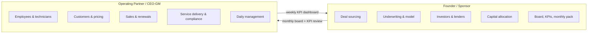
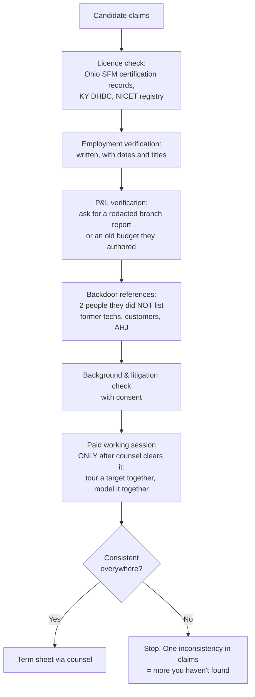

# 07 — Operating Partner Profile (Fire & Life Safety ITM)

**Date:** 2026-11-09 · Not legal advice. Equity documents need an M&A attorney and a tax adviser.

> **Immigration note before anything else:** recruiting an operator, negotiating terms and signing agreements may each count as work or business activity in your current status. Use this file to **prepare**. Do not sign, pay, or promise anything until counsel clears it (`08`).

---

## 1. Who you are looking for — one picture

```text
┌──────────────────────────────────────────────────────────────────┐
│  THE OPERATOR                                                    │
├──────────────────────────────────────────────────────────────────┤
│  10+ yrs fire & life safety · 3+ yrs running a branch P&L        │
│  ($3m+ revenue, 15+ techs) · knows NFPA 25/72/10 cold            │
│  Holds or can hold Ohio SFM certifications; NICET a plus         │
│  Has hired, fired and kept technicians in THIS labour market     │
│  Has priced inspection contracts and driven deficiency → repair   │
│  Wants ownership, not just salary · will co-invest real money    │
│  Lives within 45 min of Cincinnati · ideal age 35-55             │
└──────────────────────────────────────────────────────────────────┘
```

**Where they come from:** branch/service managers at regional and national fire companies that operate in Ohio — Koorsen, Summit, Pye-Barker, APi/CertaSite, Cintas (verify) — especially people whose employer was just acquired (F4, F5 in file 04). Consolidation creates restless, capable managers.

## 2. Responsibilities split



## 3. Experience and qualifications

| Area | Must have | Nice to have |
|---|---|---|
| Technical | Working knowledge of NFPA 25 / 72 / 10 inspection regimes (S-32); Ohio code (S-30) | NICET Level III/IV; Kentucky certificate (S-31) |
| P&L | Owned a branch or company P&L ≥ $3m revenue for ≥3 years | Ran a turnaround or integration |
| People | Hired ≥10 technicians; kept turnover below the branch's history | Built a training/apprentice ladder |
| Customers | Personally managed key property-management / facility accounts | Has relationships with Cincinnati property managers |
| Systems | Field-service software, scheduling, deficiency quoting | Implemented one |
| Character | Verified references from a former boss, a peer and a direct report | References from a customer |

## 4. Compensation and equity — a starting framework (Base case)

| Component | Proposal | Reasoning |
|---|---|---|
| Base salary + bonus | ~$175k fully loaded (A) | Replaces the owner's role; it's inside Adjusted EBITDA in the model |
| Annual bonus | 0-30% of base on EBITDA & technician-retention targets | Pays for what drives value |
| Cash co-invest | $50k-$100k at close (A) | Skin in the game; a real test of belief |
| Profits interest | **7.5%** of equity appreciation (model input) | Rewards value creation, not just showing up |
| Vesting | 4-5 years; 1-year cliff; ~half time-based, ~half on performance | Retains through the hold |
| Acceleration | Partial on sale ("double-trigger" preferred) | Avoids paying out without a change of role |

### Why NOT an equal split

| Contribution | Founder | Operator | Investors |
|---|---|---|---|
| Finds and underwrites the deal | ●●● | ● | — |
| Raises the capital | ●●● | — | — |
| Cash at risk | — (none) | ●● ($50-100k) | ●●●● ($1.9m) |
| Runs the company daily | — | ●●●● | — |
| Personal guarantee exposure | depends | depends | — |
| Replaceability | Moderate | **Low** (licences, relationships) | High |

The equity follows capital and risk first. In the Base model, investors fund ~75% of equity in cash; the founder's stake comes from a rolled fee and a promote; the operator gets co-invest plus a profits interest. A 50/50 split between founder and operator would ignore who is putting up $1.9m. **What actually decides it: who is harder to replace in year 2?** In fire protection, often the operator — so their profits interest should be meaningful, not token.

## 5. Governance terms to put in writing

| Term | Starting position |
|---|---|
| **Decision rights** | Operator: hiring below GM level, pricing within policy, capex < $25k. Board: budget, debt, acquisitions, capex > $25k, executive hiring/firing, related-party deals |
| **Board** | 3 seats to start: founder, lead investor, operator; independent industry director by year 2 |
| **Guarantees** | Personal guarantees to lenders are allocated *explicitly* — who signs, for how much, released when. Never sign one without counsel (and see `08` on immigration and SBA) |
| **Buy-sell** | Shotgun or ROFR for founder/operator; put/call on operator equity at fair market value on death, disability, departure |
| **Good leaver / bad leaver** | Good leaver keeps vested units at FMV; bad leaver (cause, competing, fraud) forfeits unvested and sells vested at the lower of cost or FMV |
| **Removal** | Board can remove the operator as GM for cause or after two consecutive quarters under 80% of budgeted EBITDA plus a cure period |
| **Restrictive covenants** | Non-solicit of employees and customers; non-compete only to the extent enforceable in Ohio/KY (counsel) |
| **Conflict resolution** | Escalation → mediation → arbitration; deadlock on budget defaults to prior-year budget + inflation |
| **Information rights** | Weekly KPI dashboard; monthly financials by day 15; annual audit or review |

## 6. Twenty interview questions

**Track record**
1. Walk me through the P&L you ran last year: revenue, gross margin, EBITDA, and the three line items you moved most.
2. What share of your branch revenue was inspection, service, monitoring and new install? How did you change that mix?
3. Tell me about a technician you lost that you should have kept. What did you change afterwards?
4. What's your inspection-to-deficiency-quote conversion rate, and how long from inspection to quote?
5. Describe the worst compliance failure on your watch — missed inspection, failed test, AHJ issue. What happened next?

**Market & customers**
6. Who are the five largest fire & life-safety competitors in Greater Cincinnati, and where is each weak?
7. Which property managers or facility directors would take your call tomorrow?
8. How do you price an annual sprinkler and alarm inspection for a 100,000 sq ft office? What's your floor?
9. What does a customer leave you for?
10. How do Northern Kentucky licensing and AHJs differ from Ohio's in practice?

**Operating**
11. Show me how you'd schedule a 15-technician inspection route for a month.
12. What software do you run on, and what would you change in the first 100 days?
13. Which KPIs would you put on a one-page weekly dashboard for me?
14. How would you handle AFFF/foam legacy issues at a customer site or in our own inventory?
15. What's a realistic annual price increase customers accept without churn?

**Partnership & character**
16. Why do you want ownership rather than a bigger salary?
17. How much of your own money would you invest, and what would make you put in more?
18. Tell me about a time you disagreed with an owner or board. How was it resolved?
19. What would make you leave a company you partly own?
20. Who should I call who will tell me something negative about you?

## 7. Verifying experience and references



**Reference-call script (5 questions):** (1) In what capacity did you work together, and for how long? (2) What would you hire them for again? (3) What would you never hire them for? (4) How did their team perform after they left? (5) On a scale of 1-10, how strongly do you recommend them — and what would make it a 10?
