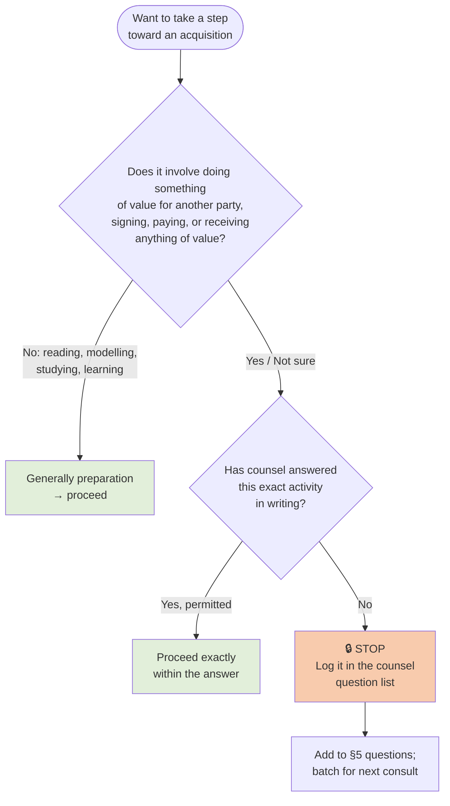
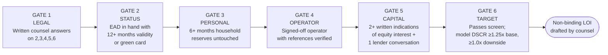

# 08 — Financing & Immigration Gates

**Date:** 2026-11-09

> **This is not legal advice.** I am not a lawyer. Nothing here says what you may or may not do. It sorts the questions so one consultation with a licensed immigration attorney, plus one with a securities/M&A attorney, answers as much as possible. Your existing file `positioning-system/18-immigration-counsel-questions.md` covers status and job-search questions; this file adds **acquisition-specific** questions. Bring both.

---

## 1. The gate map



**Standing rule (from your existing system): when in doubt, it's 🔒.**

## 2. What changed in 2025-26 that matters to you

| Date | Change | Effect on you | Source |
|---|---|---|---|
| 1-Jun-2025 | SBA SOP 50 10 8: 10% equity injection; seller note counts only on full standby for life of loan, max half of injection | Ended "zero-down" SBA structures | S-02 |
| 30-Oct-2025 | Interim final rule: no automatic EAD extension for renewals filed on/after this date; (c)(9) not excepted | A renewal gap could stop work — and any management role | S-06 |
| 5-Dec-2025 | (c)(9) EAD max validity cut from 5 years to **18 months** | More frequent renewals → more gap risk | S-04 |
| **1-Mar-2026** | **SBA requires 100% U.S. citizen/national ownership; LPRs excluded; no de-minimis** | **SBA closed to you — now, and even after your green card** | S-01 |
| 1-Oct-2026 | SOP 50 10 8.1 in force for newly numbered loans; earn-outs still barred; standby-note refinance seasoning 36 months | Relevant only once you're SBA-eligible | S-03 |

## 3. The seven activities, separated

These are **different legal questions.** Don't let anyone (including me) blur them.

| # | Activity | What it looks like in this plan | Why it's a separate question |
|---|---|---|---|
| 1 | **Employment authorisation** | Taking any job (M&A analyst, etc.) | EAD must be in hand **before** work begins (S-05); 18-month validity (S-04) |
| 2 | **Passive ownership** | Owning LLC units / shares in a company you don't manage | Holding an investment is often analysed differently from working — **counsel to confirm for your status** |
| 3 | **Active management** | Being GM, making operating decisions, supervising staff | Generally looks like work → authorisation question |
| 4 | **Self-employment** | Acting as independent sponsor: sourcing deals, underwriting, negotiating, earning closing/management fees | Fees are payment for services → likely needs authorisation; possibly broker-dealer issues too |
| 5 | **Officer / director duties** | Being a manager of the LLC, board member, signing as an officer | May be work even if unpaid |
| 6 | **Personal guarantees** | Guaranteeing a bank loan | Credit/legal exposure; lender KYC; whether it affects anything in a pending case |
| 7 | **SBA ownership eligibility** | Any ownership in an SBA borrower | **Settled by SBA rule: not eligible** (S-01). A U.S.-citizen spouse holding ownership "for" you would be a nominee arrangement — **do not.** |

### Where each sits today

```text
                       Permitted now?     Who decides
 1 Employment          NO (no EAD)        USCIS / counsel
 2 Passive ownership   ASK COUNSEL        Immigration counsel
 3 Active management   ASK COUNSEL        Immigration counsel
 4 Self-employment     ASK COUNSEL        Immigration + securities counsel
 5 Officer/director    ASK COUNSEL        Immigration counsel
 6 Personal guarantee  ASK COUNSEL        Immigration + lender + attorney
 7 SBA ownership       NO (rule)          SBA SOP 50 10 8 / 8.1
```

## 4. Financing gates — sequence that must be true before an LOI



## 5. Questions for counsel (acquisition-specific)

**Immigration attorney**

- **AQ1.** While my I-485 is pending and before I hold an EAD, may I (a) research companies, (b) talk to business owners about their businesses, (c) build models of specific companies, (d) introduce myself to brokers as a future buyer? Where does "networking" end and "self-employment" begin for an aspiring independent sponsor?
- **AQ2.** May I **own** a minority or majority interest in a U.S. operating company before I have an EAD? Does it matter whether I'm a manager or a passive member?
- **AQ3.** May I receive a **closing fee, management fee or carried interest** before I have an EAD? After the EAD? After LPR status?
- **AQ4.** May I serve as an **officer, manager or director** (unpaid) of an acquisition entity?
- **AQ5.** May I form an LLC, obtain an EIN, open a bank account, sign an NDA or an LOI as a principal?
- **AQ6.** Would signing a **personal guarantee** raise any issue for my pending adjustment?
- **AQ7.** If my EAD lapses during a renewal (18-month validity, no automatic extension), what must I stop doing — including any board or management role?
- **AQ8.** When would I first be eligible to apply for **naturalisation** based on marriage to a U.S. citizen, given my expected LPR date? (SBA eligibility depends on citizenship — S-01.)
- **AQ9.** If I later live abroad (e.g., Switzerland) for long periods as an LPR, what are the abandonment-of-residence risks and the role of a re-entry permit?
- **AQ10.** Is there any structure involving my spouse's ownership that is legitimate? (I am **not** asking how to use a nominee. I'm asking what genuine joint ownership would require and what it would not permit.)

**Securities / M&A attorney**

- **SQ1.** Raising equity from individuals for a single deal: what exemption (e.g., Reg D 506(b)), what documents, and what must I avoid saying?
- **SQ2.** Do success fees for deal sourcing trigger broker-dealer registration issues?
- **SQ3.** Asset purchase vs equity purchase for a fire-protection target with possible AFFF/PFAS history (X4 in file 04)?
- **SQ4.** Enforceability of non-competes and non-solicits for a seller and an operator in Ohio and Kentucky?

**Cross-border tax adviser (later, before any move abroad)**

- **TQ1.** 8-of-15-year long-term-resident test and covered-expatriate rules (S-39) as they apply to my timeline.
- **TQ2.** U.S. taxation of pass-through business income while resident abroad; Swiss residence options.

## 6. The Switzerland question — gate it now, decide in 5+ years

```text
 Green card held  ──►  U.S. taxes worldwide income while you are an LPR
       │
       ├─ Long absences  ──►  risk of abandonment finding (ask counsel, AQ9)
       │
       └─ 8 of 15 tax years as LPR  ──►  "long-term resident" → exit-tax tests
                                         if status later ends (S-39)
```

**Practical answer:** build the business so it runs without you — that's needed anyway. Make residency and citizenship decisions with counsel and a cross-border tax adviser **before** buying property or spending long periods abroad.

## 7. What you will NOT do (non-negotiables in legal form)

- ❌ Nominee or straw ownership through a spouse, parent or friend.
- ❌ Any statement to a lender, broker, seller or investor implying you're authorised to work when you're not.
- ❌ Accepting any fee, equity or reimbursement before counsel clears it.
- ❌ Personal credit to fund deal equity.
- ❌ Signing a personal guarantee without independent counsel.
