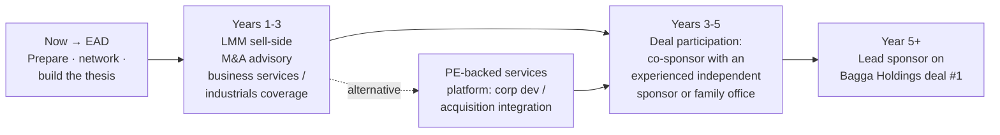
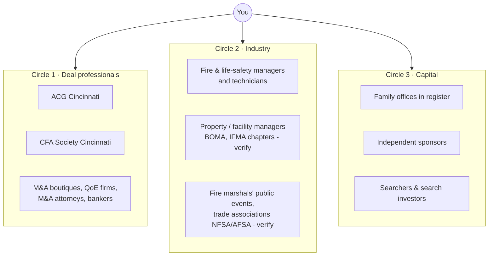

# 09 — Career & Networking Plan

**Date:** 2026-11-09 · Builds on `positioning-system/` (diagnosis, firm register, EAD-day kit). Doesn't replace it.

> **Gate:** no application is submitted and no role accepted until (a) your EAD is in hand and (b) counsel has answered whether you may interview before authorisation (`positioning-system/18` Q9). Until then, every career task is **prepare and queue**.

---

## 1. The recommendation



**Primary path: lower-middle-market (LMM) M&A advisory, sell-side, business services/industrials.**

Why this one:
1. **Deal volume with owner-run companies.** You see how owners think, why they sell, how CIMs, LOIs, QoE and closing actually work.
2. **It builds the exact network you lack:** business owners, PE buyers and family offices (your future capital providers), lenders, M&A attorneys, QoE firms.
3. **Credibility test passed:** "closed X sell-side deals" is the sentence that gets capital providers to back a first-time sponsor.
4. **No non-compete conflict** with your future fire-protection thesis. A corp-dev job at a fire consolidator would teach the industry but may restrict you later (non-competes, confidentiality) — and using its pipeline would be wrong.

## 2. Seven paths compared

| Path | Prepares you for acquisitions | Access for you after EAD (A) | Builds investor network | Conflict risk with own deals | Verdict |
|---|---|---|---|---|---|
| **LMM M&A advisory (sell-side)** | ●●●●● | ●●●● | ●●●● | Low | **#1** |
| PE-backed company finance / corp dev | ●●●● | ●●●● | ●● | **Medium–high** in same industry | **#2** (choose a non-fire platform) |
| Search-fund / independent-sponsor analyst | ●●●●● | ●● (few roles, small teams) | ●●●●● | Low | Opportunistic — take it if offered |
| Transaction advisory (QoE) | ●●●● | ●●●● | ●●● | Low | Strong #3 — makes you dangerous in diligence |
| Lower-middle-market private equity | ●●●●● | ●● (competitive) | ●●●●● | Low | Aim for it after 2 years of M&A |
| Corporate development (strategic) | ●●● | ●●● | ●● | Medium | Fine, slower |
| Portfolio operations | ●●●● | ● (needs experience) | ●●● | Low | Later |

Your existing positioning system ranked paths for *positioning* (independent sponsors 88, LMM PE 80, search 78, valuation/TAS 76…). This file ranks them for **preparing to acquire**. Both put LMM deal work at the centre.

## 3. Target job titles (search strings)

```text
"M&A Analyst" OR "Investment Banking Analyst" lower middle market
"Associate, M&A Advisory" · "Sell-Side M&A Associate"
"Transaction Advisory Services" OR "Quality of Earnings" Associate
"Valuation Analyst" (business valuation)
"Acquisitions Analyst" · "Corporate Development Analyst"
"Private Equity Analyst" lower middle market · "Search Fund Associate"
"FP&A Analyst" private equity-backed (services)
```

## 4. Employers to research (from your verified firm register)

Use `positioning-system/data/firms-cincinnati.csv` — those rows are already sourced and status-tagged. Don't rely on new names from memory.

| Type | Register IDs | Use |
|---|---|---|
| Cincinnati M&A advisory | FIRM-006 RKCA, FIRM-007 Silverstone, FIRM-008 REAG, FIRM-009 MelCap (NE Ohio) | Primary employers |
| LMM PE | FIRM-001 Roebling, FIRM-002 RC Capital, FIRM-003 Brixey & Meyer, FIRM-004 Revitalize, FIRM-014 Stonehenge, FIRM-017 Centerfield | Future buyers of your deals; future co-investors |
| Mezzanine / private credit | FIRM-005 Northcreek | Future lender knowledge |
| Family offices | FIRM-010 Cincinnatus Partners, FIRM-011 Loring Group, FIRM-012 Vigran, FIRM-013 Argentarii, FIRM-015 Crane Group | **Future equity for deal #1** — relationships take years |
| Fire & life-safety platforms (learning only) | Summit, Pye-Barker, APi/CertaSite, Koorsen, Cintas | Industry knowledge, operator pool. **Not** primary employers (conflict risk) |

## 5. Skills to develop (in this order)

| # | Skill | Evidence you'll produce | Where in the 90 days |
|---|---|---|---|
| 1 | QoE-style EBITDA normalisation | Adjustments memo on a case | Weeks 2-4 |
| 2 | Small-company LBO / DSCR | `06` model rebuilt from scratch, unaided | Weeks 3-6 |
| 3 | Working-capital pegs & purchase-price mechanics | One-page explainer | Week 6 |
| 4 | LOI terms (price, structure, exclusivity, conditions) | Annotated sample LOI | Week 9 |
| 5 | Fire & life-safety code literacy (NFPA 25/72/10, Ohio 1301:7-7-09) | One-page cheat sheet | Weeks 1-3 |
| 6 | Owner conversations | 10 informational conversations logged | Weeks 4-12 |
| 7 | Investor memo writing | 6-page fire ITM thesis memo | Weeks 8-12 |

## 6. Résumé positioning

**First, fix the degree line:** it is **M.S. Finance** (UC Lindner), plus the Graduate Certificate in Quantitative Finance — **not "MS Financial Mathematics"** (R-01). The other corrections in `positioning-system/01-diagnosis.md` §B still apply.

**Headline (from your existing system):** *Private-company analyst — valuation and acquisition underwriting for businesses with no market price and no clean data.*

**Top three bullets to lead with (rewrite with your real numbers):**
- Built bottoms-up acquisition underwriting (IRR/MOIC, purchase-price sensitivity) across a $6M+ multi-state pipeline; wrote go/no-go memos to the Managing Partner.
- Normalised EBITDA and built DCF/comps valuations ($3.5M–$21M) for private companies starting from raw bank statements.
- Prepared Reg D LP-facing materials for a deal-by-deal private-equity platform.

**Add after 60 days:** "Independent research: Ohio fire & life-safety acquisition thesis — 20-transaction case library, industry scorecard, LBO/DSCR model." (Unpaid, self-initiated research — confirm with counsel that publishing it is fine: `positioning-system/18` Q5.)

**Work-authorisation line:** never claim present authorisation. Use the phrasing approved in your system: *"Completing a green-card process through marriage to a U.S. citizen — authorised with no sponsorship required once issued."* (Confirm wording with counsel.)

## 7. Interview preparation — the 12 answers to own

| # | Question | Your angle |
|---|---|---|
| 1 | Walk me through your résumé | Private-company underwriting → why LMM M&A |
| 2 | Why sell-side M&A? | Volume of owner-run deals; you want to see 100 businesses |
| 3 | Walk me through a deal you underwrote | Turnkey pipeline — a go/no-go memo |
| 4 | How do you normalise EBITDA? | Add-backs vs **replacement cost of the owner** |
| 5 | What drives value in a services business? | Recurring revenue, density, technician retention |
| 6 | Pitch me an industry | Fire & life safety ITM — code-mandated demand, Ohio deal flow (F5, S-44) |
| 7 | Walk me through an LBO | Use `06` Base case numbers |
| 8 | What's DSCR and why does it matter for small deals? | Base case Year-3 pinch when the seller note amortises |
| 9 | What's a working-capital peg? | Normalised NWC; seasonality |
| 10 | Tell me about a mistake | A real one; what you changed |
| 11 | Why Cincinnati? | Rooted here; spouse; long-term relationships |
| 12 | Work authorisation? | Approved phrasing only |

## 8. Networking strategy — three circles



**Weekly quota (fits the daily-3 system):** 2 new contacts + 2 follow-ups + 1 informational conversation. Follow-ups always beat new names (`positioning-system/17` §1-2).

**Scripts:** use `positioning-system/09-networking-system.md`. Never ask for a job; ask about their judgment. Under 150 words.

## 9. 90-day job-search plan (status-aware)

| Phase | Days | Output | Status gate |
|---|---|---|---|
| **Foundation** | 1-30 | Résumé corrected; 3 résumé variants (M&A, TAS, PE-backed finance); LinkedIn updated; 30 target firms ranked; 12 interview answers drafted | None — preparation |
| **Conversations** | 31-60 | 8-10 informational conversations; 5 warm contacts at target firms; 1 published research piece (if counsel OK) | Counsel answer on publishing |
| **Pipeline-ready** | 61-90 | 10 tailored application packets **queued, not sent**; referral asks drafted; mock interviews ×3 | **Submit only when EAD in hand and counsel confirms** |
| **EAD day** | — | Run `positioning-system/14-ead-arrival-and-100-day.md` §3 within 24 hours | EAD received |
