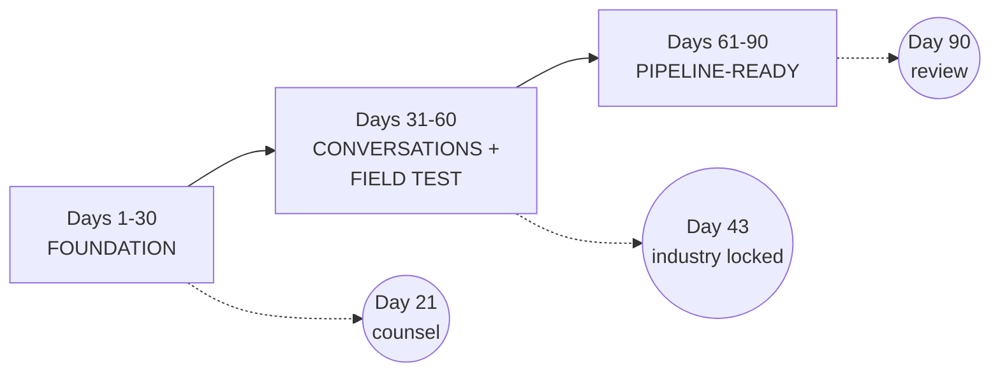

# 10 — 90-Day Execution Calendar

**Day 1 = Tue 10 Nov 2026** · **Day 90 = Sun 07 Feb 2027** · Generated by `data/build_calendar.py` (edit there, re-run).

**Rules:** exactly **three** goals a day, always in this order. **1 CAREER / INCOME · 2 ACQUISITION INTELLIGENCE · 3 NETWORK / FINANCIAL FOUNDATION.** Weekdays run 60–120 min, Saturdays ~60, Sundays ~65 (weekly review). Holidays are deliberately light.

> **Status gate:** career tasks are *prepare and queue* until your EAD is in hand and counsel confirms (file 09). Any task touching fees, equity, signing or outreach to sellers waits for written counsel clearance (file 08).

## Milestones

| Day | Date | Milestone |
|---:|---|---|
| 7 | Mon 16 Nov | Counsel consult requested · résumé corrected · 25 target rows |
| 14 | Mon 23 Nov | 40 target rows · cases 1-2 done · code cheat sheet |
| 21 | Mon 30 Nov | Counsel consult held (target) · LBO rebuild started · 10 CRM contacts |
| 30 | Wed 09 Dec | PHASE-1 REVIEW · 60 rows · 4 cases · 3 résumé variants · 3 conversation requests |
| 43 | Tue 22 Dec | INDUSTRY DECISION LOCKED (fire or pest) |
| 60 | Fri 08 Jan | PHASE-2 REVIEW · 8 conversations · 8 cases · 5 operator candidates |
| 75 | Sat 23 Jan | 10 packets queued · operator pipeline 10 · 15 conversations requested |
| 90 | Sun 07 Feb | 90-DAY REVIEW · thesis memo final · 100 rows · 13 cases |

## PHASE 1 — FOUNDATION (Days 1–30)

*Counsel booked & held · résumé corrected · thesis literacy · target list · model rebuilt*

### Week 1 — case: A2 ABM ← Able (worked example, file 05 §4) · skill: NFPA 25/72/10 + Ohio 1301:7-7-09 cheat sheet

**Day 1 · Tue 10 Nov 2026 · 120 min**

- [ ] **1 CAREER** — Change degree to 'M.S. Finance' on résumé, LinkedIn, bios · ⏱ 30 min · 📦 Corrected résumé + LinkedIn · ✅ *Zero occurrences of 'Financial Mathematics'*
- [ ] **2 ACQUISITION** — Run the 2 Census CBP queries (file 03 §A2); start target sheet from Ohio SFM certified-company records · ⏱ 60 min · 📦 Target sheet with ≥25 sourced rows · ✅ *≥25 rows, each with source URL*
- [ ] **3 NETWORK/FIN** — Email 3 immigration attorneys (AILA directory) to book a consult; attach file 08 §5 AQ1-AQ10 · ⏱ 30 min · 📦 3 emails sent · ✅ *3 sent; consult date requested*

**Day 2 · Wed 11 Nov 2026 · 105 min**

- [ ] **1 CAREER** — Apply the other résumé fixes in positioning-system/01-diagnosis.md §B · ⏱ 40 min · 📦 Résumé v-corrected · ✅ *All 4 flagged claims fixed or removed*
- [ ] **2 ACQUISITION** — Read files 02 and 03 end-to-end; write the 3 reasons to reject fire in your own words · ⏱ 40 min · 📦 3-line note · ✅ *Saved*
- [ ] **3 NETWORK/FIN** — Set up CRM tabs: Deal pros / Industry / Capital / Operators · ⏱ 25 min · 📦 CRM with 4 tabs + columns · ✅ *Tabs exist; 0 unsourced rows*

**Day 3 · Thu 12 Nov 2026 · 75 min**

- [ ] **1 CAREER** — Draft 'Why sell-side M&A?' answer · ⏱ 25 min · 📦 Answer ≤200 words · ✅ *Rehearsed aloud twice*
- [ ] **2 ACQUISITION** — Case A2 worked example (file 05 §4): redo every calculation yourself without looking · ⏱ 35 min · 📦 Your own D-table for ABM/Able · ✅ *Your 12.8x and 8.3x match the file*
- [ ] **3 NETWORK/FIN** — Follow up with attorneys not yet replied; confirm a consult date · ⏱ 15 min · 📦 Consult date confirmed or 2nd round sent · ✅ *Logged*

**Day 4 · Fri 13 Nov 2026 · 80 min**

- [ ] **1 CAREER** — Update LinkedIn activity: comment thoughtfully on 2 posts from target firms · ⏱ 20 min · 📦 2 comments · ✅ *Posted; no claims of authorisation*
- [ ] **2 ACQUISITION** — Industry reading: 1 trade/industry article on fire & life safety M&A; 3 bullet takeaways · ⏱ 30 min · 📦 3 bullets in research log · ✅ *Logged with URL + date*
- [ ] **3 NETWORK/FIN** — Write the household budget baseline together (actual last 3 months) · ⏱ 30 min · 📦 Budget sheet with monthly total · ✅ *Done and noted in money log*

**Day 5 · Sat 14 Nov 2026 · 65 min**

- [ ] **1 CAREER** — Light: read file 04 'At a glance' table (20 min) · ⏱ 20 min · 📦 3 bullets · ✅ *Logged*
- [ ] **2 ACQUISITION** — Start the NFPA 25/72/10 + Ohio 1301:7-7-09 cheat sheet (sources: S-30, S-32) · ⏱ 30 min · 📦 Half-page draft · ✅ *Saved; finish on Wed of week 2*
- [ ] **3 NETWORK/FIN** — Light: 15 min — reply to messages; protect the rest of the day · ⏱ 15 min · 📦 Inbox for contacts = 0 · ✅ *Done*

**Day 6 · Sun 15 Nov 2026 · 65 min**

- [ ] **1 CAREER** — Weekly review: score the week (file 11 scorecard) · ⏱ 25 min · 📦 Weekly scorecard filled · ✅ *Score recorded on dashboard*
- [ ] **2 ACQUISITION** — Risk register review (file 12) + set next week's acquisition focus · ⏱ 20 min · 📦 Updated register; next week's case chosen · ✅ *Initialled & dated*
- [ ] **3 NETWORK/FIN** — Plan next week's outreach (names for Mon/Wed/Thu) + protected time with spouse · ⏱ 20 min · 📦 5 names queued; family block on calendar · ✅ *Calendar updated*

### Week 2 — case: F5 Summit ← Total Life Safety (West Chester OH) · skill: EBITDA normalisation: add-backs vs owner replacement cost

**Day 7 · Mon 16 Nov 2026 · 100 min** · ⭐ **Counsel consult requested · résumé corrected · 25 target rows**

- [ ] **1 CAREER** — Tailor one résumé variant (rotate: M&A / TAS / PE-backed finance) · ⏱ 30 min · 📦 1 résumé file saved, dated · ✅ *File saved; no 'Financial Mathematics', no authorisation claim*
- [ ] **2 ACQUISITION** — Case study part 1 — facts & economics: F5 Summit ← Total Life Safety (West Chester OH) · ⏱ 45 min · 📦 Case card fields 1-8 filled · ✅ *Every number has a source ID or 'n/d'*
- [ ] **3 NETWORK/FIN** — Identify 2 new contacts (Circle 1-3, file 09 §8) and log in CRM · ⏱ 25 min · 📦 2 CRM rows with source URL · ✅ *2 rows saved with today's date*

**Day 8 · Tue 17 Nov 2026 · 100 min**

- [ ] **1 CAREER** — Draft & rehearse interview answer: 'Why sell-side M&A?' · ⏱ 30 min · 📦 Written answer ≤200 words + 1 recorded run · ✅ *Said aloud twice; recording kept*
- [ ] **2 ACQUISITION** — Grow the target list to 40 rows (SFM certified companies, CBP, websites) · ⏱ 45 min · 📦 Target sheet at 40 rows · ✅ *Each row: name, city, source URL; no revenue guesses*
- [ ] **3 NETWORK/FIN** — Send follow-ups due in CRM (follow-ups beat new names) · ⏱ 25 min · 📦 All due follow-ups sent · ✅ *CRM 'Follow-up due' count = 0*

**Day 9 · Wed 18 Nov 2026 · 95 min**

- [ ] **1 CAREER** — Research employers: FIRM-008 REAG + FIRM-009 MelCap · ⏱ 30 min · 📦 2 employer notes (deal types, team, sector) · ✅ *Notes saved with source URLs*
- [ ] **2 ACQUISITION** — Skill block: EBITDA normalisation: add-backs vs owner replacement cost · ⏱ 45 min · 📦 1-page adjustments memo on a case · ✅ *Deliverable saved in /bagga-acquisition-research/notes*
- [ ] **3 NETWORK/FIN** — Request 1 informational conversation (never a job ask) · ⏱ 20 min · 📦 1 request sent · ✅ *Message sent and logged*

**Day 10 · Thu 19 Nov 2026 · 95 min**

- [ ] **1 CAREER** — Technical drill: 20 min LBO/accounting flashcards + 1 timed mini-model · ⏱ 30 min · 📦 Mini-model saved · ✅ *Completed within 25 min*
- [ ] **2 ACQUISITION** — Case study part 2 — verdict (questions I-J): F5 Summit ← Total Life Safety (West Chester OH) · ⏱ 40 min · 📦 Verdict + 'what I'd negotiate' · ✅ *One-line lesson added to lessons log*
- [ ] **3 NETWORK/FIN** — Read 07 §1-3; write your 5 operator must-haves in your own words · ⏱ 25 min · 📦 5-line operator spec · ✅ *Saved*

**Day 11 · Fri 20 Nov 2026 · 80 min**

- [ ] **1 CAREER** — Update LinkedIn activity: comment thoughtfully on 2 posts from target firms · ⏱ 20 min · 📦 2 comments · ✅ *Posted; no claims of authorisation*
- [ ] **2 ACQUISITION** — Industry reading: 1 trade/industry article on fire & life safety M&A; 3 bullet takeaways · ⏱ 30 min · 📦 3 bullets in research log · ✅ *Logged with URL + date*
- [ ] **3 NETWORK/FIN** — Open/label a separate high-yield account for the 2-3-yr reserve · ⏱ 30 min · 📦 Account exists, named 'Reserve' · ✅ *Done and noted in money log*

**Day 12 · Sat 21 Nov 2026 · 65 min**

- [ ] **1 CAREER** — Light: read one chapter / article on M&A process (20 min) · ⏱ 20 min · 📦 3 bullets · ✅ *Logged*
- [ ] **2 ACQUISITION** — Light: enrich 5 target rows (service lines, # locations from websites) · ⏱ 30 min · 📦 5 enriched rows · ✅ *Fields filled with source URL*
- [ ] **3 NETWORK/FIN** — Light: 15 min — reply to any messages; protect the rest of the day for family · ⏱ 15 min · 📦 Inbox for contacts = 0 · ✅ *Done*

**Day 13 · Sun 22 Nov 2026 · 65 min**

- [ ] **1 CAREER** — Weekly review: score the week (file 11 scorecard) · ⏱ 25 min · 📦 Weekly scorecard filled · ✅ *Score recorded on dashboard*
- [ ] **2 ACQUISITION** — Risk register review (file 12) + set next week's acquisition focus · ⏱ 20 min · 📦 Updated register; next week's case chosen · ✅ *Initialled & dated*
- [ ] **3 NETWORK/FIN** — Plan next week's outreach (names for Mon/Wed/Thu) + protected time with spouse · ⏱ 20 min · 📦 5 names queued; family block on calendar · ✅ *Calendar updated*

### Week 3 — case: A1 Rollins ← Fox Pest Control · skill: Rebuild the LBO from blank: sources & uses + P&L

**Day 14 · Mon 23 Nov 2026 · 100 min** · ⭐ **40 target rows · cases 1-2 done · code cheat sheet**

- [ ] **1 CAREER** — Tailor one résumé variant (rotate: M&A / TAS / PE-backed finance) · ⏱ 30 min · 📦 1 résumé file saved, dated · ✅ *File saved; no 'Financial Mathematics', no authorisation claim*
- [ ] **2 ACQUISITION** — Case study part 1 — facts & economics: A1 Rollins ← Fox Pest Control · ⏱ 45 min · 📦 Case card fields 1-8 filled · ✅ *Every number has a source ID or 'n/d'*
- [ ] **3 NETWORK/FIN** — Identify 2 new contacts (Circle 1-3, file 09 §8) and log in CRM · ⏱ 25 min · 📦 2 CRM rows with source URL · ✅ *2 rows saved with today's date*

**Day 15 · Tue 24 Nov 2026 · 100 min**

- [ ] **1 CAREER** — Draft & rehearse interview answer: 'Walk me through a deal you underwrote' · ⏱ 30 min · 📦 Written answer ≤200 words + 1 recorded run · ✅ *Said aloud twice; recording kept*
- [ ] **2 ACQUISITION** — Grow the target list to 50 rows (SFM certified companies, CBP, websites) · ⏱ 45 min · 📦 Target sheet at 50 rows · ✅ *Each row: name, city, source URL; no revenue guesses*
- [ ] **3 NETWORK/FIN** — Send follow-ups due in CRM (follow-ups beat new names) · ⏱ 25 min · 📦 All due follow-ups sent · ✅ *CRM 'Follow-up due' count = 0*

**Day 16 · Wed 25 Nov 2026 · 95 min**

- [ ] **1 CAREER** — Research employers: FIRM-001 Roebling + FIRM-002 RC Capital · ⏱ 30 min · 📦 2 employer notes (deal types, team, sector) · ✅ *Notes saved with source URLs*
- [ ] **2 ACQUISITION** — Skill block: Rebuild the LBO from blank: sources & uses + P&L · ⏱ 45 min · 📦 Your own sheet matching file 06 Base S&U · ✅ *Deliverable saved in /bagga-acquisition-research/notes*
- [ ] **3 NETWORK/FIN** — Request 1 informational conversation (never a job ask) · ⏱ 20 min · 📦 1 request sent · ✅ *Message sent and logged*

**Day 17 · Thu 26 Nov 2026 · 30 min**

- [ ] **1 CAREER** — Thanksgiving — light: 10 min re-read your 30-second introduction · ⏱ 10 min · 📦 Read once · ✅ *Done*
- [ ] **2 ACQUISITION** — Light: note one thing learned this month about fire ITM · ⏱ 10 min · 📦 1 sentence · ✅ *Logged*
- [ ] **3 NETWORK/FIN** — Family day. Send 1 thank-you note to someone who helped you · ⏱ 10 min · 📦 1 note · ✅ *Sent*

**Day 18 · Fri 27 Nov 2026 · 80 min**

- [ ] **1 CAREER** — Update LinkedIn activity: comment thoughtfully on 2 posts from target firms · ⏱ 20 min · 📦 2 comments · ✅ *Posted; no claims of authorisation*
- [ ] **2 ACQUISITION** — Industry reading: 1 trade/industry article on fire & life safety M&A; 3 bullet takeaways · ⏱ 30 min · 📦 3 bullets in research log · ✅ *Logged with URL + date*
- [ ] **3 NETWORK/FIN** — Get 2 term-life quotes for each spouse · ⏱ 30 min · 📦 4 quotes saved · ✅ *Done and noted in money log*

**Day 19 · Sat 28 Nov 2026 · 65 min**

- [ ] **1 CAREER** — Light: read one chapter / article on M&A process (20 min) · ⏱ 20 min · 📦 3 bullets · ✅ *Logged*
- [ ] **2 ACQUISITION** — Light: enrich 5 target rows (service lines, # locations from websites) · ⏱ 30 min · 📦 5 enriched rows · ✅ *Fields filled with source URL*
- [ ] **3 NETWORK/FIN** — Light: 15 min — reply to any messages; protect the rest of the day for family · ⏱ 15 min · 📦 Inbox for contacts = 0 · ✅ *Done*

**Day 20 · Sun 29 Nov 2026 · 65 min**

- [ ] **1 CAREER** — Weekly review: score the week (file 11 scorecard) · ⏱ 25 min · 📦 Weekly scorecard filled · ✅ *Score recorded on dashboard*
- [ ] **2 ACQUISITION** — Risk register review (file 12) + set next week's acquisition focus · ⏱ 20 min · 📦 Updated register; next week's case chosen · ✅ *Initialled & dated*
- [ ] **3 NETWORK/FIN** — Plan next week's outreach (names for Mon/Wed/Thu) + protected time with spouse · ⏱ 20 min · 📦 5 names queued; family block on calendar · ✅ *Calendar updated*

### Week 4 — case: F1 APi ← Chubb · skill: Rebuild the LBO: debt schedule + DSCR

**Day 21 · Mon 30 Nov 2026 · 105 min** · ⭐ **Counsel consult held (target) · LBO rebuild started · 10 CRM contacts**

- [ ] **1 CAREER** — Counsel consult target date: bring files 08 + positioning-system/18 · ⏱ 60 min · 📦 Written answers or follow-up letter requested · ✅ *Answers saved to /06 Immigration*
- [ ] **2 ACQUISITION** — Update file 08 §3 table with counsel's answers (permitted / not / pending) · ⏱ 30 min · 📦 Updated table · ✅ *Every row has a status*
- [ ] **3 NETWORK/FIN** — Flag any activity now cleared/blocked in CRM + calendar · ⏱ 15 min · 📦 Flags updated · ✅ *Done*

**Day 22 · Tue 01 Dec 2026 · 100 min**

- [ ] **1 CAREER** — Draft & rehearse interview answer: 'How do you normalise EBITDA?' · ⏱ 30 min · 📦 Written answer ≤200 words + 1 recorded run · ✅ *Said aloud twice; recording kept*
- [ ] **2 ACQUISITION** — Grow the target list to 60 rows (SFM certified companies, CBP, websites) · ⏱ 45 min · 📦 Target sheet at 60 rows · ✅ *Each row: name, city, source URL; no revenue guesses*
- [ ] **3 NETWORK/FIN** — Send follow-ups due in CRM (follow-ups beat new names) · ⏱ 25 min · 📦 All due follow-ups sent · ✅ *CRM 'Follow-up due' count = 0*

**Day 23 · Wed 02 Dec 2026 · 95 min**

- [ ] **1 CAREER** — Research employers: FIRM-003 Brixey & Meyer + FIRM-004 Revitalize · ⏱ 30 min · 📦 2 employer notes (deal types, team, sector) · ✅ *Notes saved with source URLs*
- [ ] **2 ACQUISITION** — Skill block: Rebuild the LBO: debt schedule + DSCR · ⏱ 45 min · 📦 Your DSCR within ±0.02x of file 06 Base · ✅ *Deliverable saved in /bagga-acquisition-research/notes*
- [ ] **3 NETWORK/FIN** — Request 1 informational conversation (never a job ask) · ⏱ 20 min · 📦 1 request sent · ✅ *Message sent and logged*

**Day 24 · Thu 03 Dec 2026 · 95 min**

- [ ] **1 CAREER** — Technical drill: 20 min LBO/accounting flashcards + 1 timed mini-model · ⏱ 30 min · 📦 Mini-model saved · ✅ *Completed within 25 min*
- [ ] **2 ACQUISITION** — Case study part 2 — verdict (questions I-J): F1 APi ← Chubb · ⏱ 40 min · 📦 Verdict + 'what I'd negotiate' · ✅ *One-line lesson added to lessons log*
- [ ] **3 NETWORK/FIN** — Operator pipeline: identify 1 potential operator (branch/service manager) · ⏱ 25 min · 📦 1 operator row in CRM · ✅ *Row has employer, title, source URL*

**Day 25 · Fri 04 Dec 2026 · 80 min**

- [ ] **1 CAREER** — Update LinkedIn activity: comment thoughtfully on 2 posts from target firms · ⏱ 20 min · 📦 2 comments · ✅ *Posted; no claims of authorisation*
- [ ] **2 ACQUISITION** — Industry reading: 1 trade/industry article on fire & life safety M&A; 3 bullet takeaways · ⏱ 30 min · 📦 3 bullets in research log · ✅ *Logged with URL + date*
- [ ] **3 NETWORK/FIN** — Get 1 long-term disability quote · ⏱ 30 min · 📦 Quote saved · ✅ *Done and noted in money log*

**Day 26 · Sat 05 Dec 2026 · 65 min**

- [ ] **1 CAREER** — Light: read one chapter / article on M&A process (20 min) · ⏱ 20 min · 📦 3 bullets · ✅ *Logged*
- [ ] **2 ACQUISITION** — Light: enrich 5 target rows (service lines, # locations from websites) · ⏱ 30 min · 📦 5 enriched rows · ✅ *Fields filled with source URL*
- [ ] **3 NETWORK/FIN** — Light: 15 min — reply to any messages; protect the rest of the day for family · ⏱ 15 min · 📦 Inbox for contacts = 0 · ✅ *Done*

**Day 27 · Sun 06 Dec 2026 · 65 min**

- [ ] **1 CAREER** — Weekly review: score the week (file 11 scorecard) · ⏱ 25 min · 📦 Weekly scorecard filled · ✅ *Score recorded on dashboard*
- [ ] **2 ACQUISITION** — Risk register review (file 12) + set next week's acquisition focus · ⏱ 20 min · 📦 Updated register; next week's case chosen · ✅ *Initialled & dated*
- [ ] **3 NETWORK/FIN** — Plan next week's outreach (names for Mon/Wed/Thu) + protected time with spouse · ⏱ 20 min · 📦 5 names queued; family block on calendar · ✅ *Calendar updated*

### Week 5 — case: X1 Zips Car Wash (failure) · skill: Working-capital peg mechanics

**Day 28 · Mon 07 Dec 2026 · 100 min**

- [ ] **1 CAREER** — Tailor one résumé variant (rotate: M&A / TAS / PE-backed finance) · ⏱ 30 min · 📦 1 résumé file saved, dated · ✅ *File saved; no 'Financial Mathematics', no authorisation claim*
- [ ] **2 ACQUISITION** — Case study part 1 — facts & economics: X1 Zips Car Wash (failure) · ⏱ 45 min · 📦 Case card fields 1-8 filled · ✅ *Every number has a source ID or 'n/d'*
- [ ] **3 NETWORK/FIN** — Identify 2 new contacts (Circle 1-3, file 09 §8) and log in CRM · ⏱ 25 min · 📦 2 CRM rows with source URL · ✅ *2 rows saved with today's date*

**Day 29 · Tue 08 Dec 2026 · 100 min**

- [ ] **1 CAREER** — Draft & rehearse interview answer: 'What drives value in a services business?' · ⏱ 30 min · 📦 Written answer ≤200 words + 1 recorded run · ✅ *Said aloud twice; recording kept*
- [ ] **2 ACQUISITION** — Grow the target list to 70 rows (SFM certified companies, CBP, websites) · ⏱ 45 min · 📦 Target sheet at 70 rows · ✅ *Each row: name, city, source URL; no revenue guesses*
- [ ] **3 NETWORK/FIN** — Send follow-ups due in CRM (follow-ups beat new names) · ⏱ 25 min · 📦 All due follow-ups sent · ✅ *CRM 'Follow-up due' count = 0*

**Day 30 · Wed 09 Dec 2026 · 90 min** · ⭐ **PHASE-1 REVIEW · 60 rows · 4 cases · 3 résumé variants · 3 conversation requests**

- [ ] **1 CAREER** — Phase-1 review: résumé variants ×3 done? 12 answers drafted? (file 11 milestones) · ⏱ 30 min · 📦 Milestone checklist · ✅ *Each item ✔ or reason written*
- [ ] **2 ACQUISITION** — Phase-1 review: target list ≥60, 4 cases done, model rebuilt · ⏱ 30 min · 📦 Acquisition milestone checklist · ✅ *Each item ✔ or reason written*
- [ ] **3 NETWORK/FIN** — Phase-1 review: contacts in CRM ≥10, 3 conversation requests sent; reserve % recorded · ⏱ 30 min · 📦 Network/money checklist · ✅ *Each item ✔ or reason written*

## PHASE 2 — CONVERSATIONS & FIELD TEST (Days 31–60)

*Informational conversations · fire-vs-pest field test · industry locked · operator pipeline*

### Week 5 — case: X1 Zips Car Wash (failure) · skill: Working-capital peg mechanics

**Day 31 · Thu 10 Dec 2026 · 95 min**

- [ ] **1 CAREER** — Technical drill: 20 min LBO/accounting flashcards + 1 timed mini-model · ⏱ 30 min · 📦 Mini-model saved · ✅ *Completed within 25 min*
- [ ] **2 ACQUISITION** — Case study part 2 — verdict (questions I-J): X1 Zips Car Wash (failure) · ⏱ 40 min · 📦 Verdict + 'what I'd negotiate' · ✅ *One-line lesson added to lessons log*
- [ ] **3 NETWORK/FIN** — Operator pipeline: identify 1 potential operator (branch/service manager) · ⏱ 25 min · 📦 1 operator row in CRM · ✅ *Row has employer, title, source URL*

**Day 32 · Fri 11 Dec 2026 · 80 min**

- [ ] **1 CAREER** — Update LinkedIn activity: comment thoughtfully on 2 posts from target firms · ⏱ 20 min · 📦 2 comments · ✅ *Posted; no claims of authorisation*
- [ ] **2 ACQUISITION** — Industry reading: 1 trade/industry article on fire & life safety M&A; 3 bullet takeaways · ⏱ 30 min · 📦 3 bullets in research log · ✅ *Logged with URL + date*
- [ ] **3 NETWORK/FIN** — List 3 estate attorneys for wills/POA (incl. QDOT question, file 14 §5) · ⏱ 30 min · 📦 3 names + contact · ✅ *Done and noted in money log*

**Day 33 · Sat 12 Dec 2026 · 65 min**

- [ ] **1 CAREER** — Light: read one chapter / article on M&A process (20 min) · ⏱ 20 min · 📦 3 bullets · ✅ *Logged*
- [ ] **2 ACQUISITION** — Light: enrich 5 target rows (service lines, # locations from websites) · ⏱ 30 min · 📦 5 enriched rows · ✅ *Fields filled with source URL*
- [ ] **3 NETWORK/FIN** — Light: 15 min — reply to any messages; protect the rest of the day for family · ⏱ 15 min · 📦 Inbox for contacts = 0 · ✅ *Done*

**Day 34 · Sun 13 Dec 2026 · 65 min**

- [ ] **1 CAREER** — Weekly review: score the week (file 11 scorecard) · ⏱ 25 min · 📦 Weekly scorecard filled · ✅ *Score recorded on dashboard*
- [ ] **2 ACQUISITION** — Risk register review (file 12) + set next week's acquisition focus · ⏱ 20 min · 📦 Updated register; next week's case chosen · ✅ *Initialled & dated*
- [ ] **3 NETWORK/FIN** — Plan next week's outreach (names for Mon/Wed/Thu) + protected time with spouse · ⏱ 20 min · 📦 5 names queued; family block on calendar · ✅ *Calendar updated*

### Week 6 — case: F3 + F4 CertaSite build → APi exit · skill: QoE red flags: cash revenue, add-back inflation

**Day 35 · Mon 14 Dec 2026 · 100 min**

- [ ] **1 CAREER** — Tailor one résumé variant (rotate: M&A / TAS / PE-backed finance) · ⏱ 30 min · 📦 1 résumé file saved, dated · ✅ *File saved; no 'Financial Mathematics', no authorisation claim*
- [ ] **2 ACQUISITION** — Case study part 1 — facts & economics: F3 + F4 CertaSite build → APi exit · ⏱ 45 min · 📦 Case card fields 1-8 filled · ✅ *Every number has a source ID or 'n/d'*
- [ ] **3 NETWORK/FIN** — Identify 2 new contacts (Circle 1-3, file 09 §8) and log in CRM · ⏱ 25 min · 📦 2 CRM rows with source URL · ✅ *2 rows saved with today's date*

**Day 36 · Tue 15 Dec 2026 · 100 min**

- [ ] **1 CAREER** — Draft & rehearse interview answer: 'Pitch me an industry (fire ITM)' · ⏱ 30 min · 📦 Written answer ≤200 words + 1 recorded run · ✅ *Said aloud twice; recording kept*
- [ ] **2 ACQUISITION** — Grow the target list to 75 rows (SFM certified companies, CBP, websites) · ⏱ 45 min · 📦 Target sheet at 75 rows · ✅ *Each row: name, city, source URL; no revenue guesses*
- [ ] **3 NETWORK/FIN** — Send follow-ups due in CRM (follow-ups beat new names) · ⏱ 25 min · 📦 All due follow-ups sent · ✅ *CRM 'Follow-up due' count = 0*

**Day 37 · Wed 16 Dec 2026 · 95 min**

- [ ] **1 CAREER** — Research employers: FIRM-005 Northcreek + FIRM-015 Crane Group · ⏱ 30 min · 📦 2 employer notes (deal types, team, sector) · ✅ *Notes saved with source URLs*
- [ ] **2 ACQUISITION** — Skill block: QoE red flags: cash revenue, add-back inflation · ⏱ 45 min · 📦 List of 10 red flags with tests · ✅ *Deliverable saved in /bagga-acquisition-research/notes*
- [ ] **3 NETWORK/FIN** — Request 1 informational conversation (never a job ask) · ⏱ 20 min · 📦 1 request sent · ✅ *Message sent and logged*

**Day 38 · Thu 17 Dec 2026 · 85 min**

- [ ] **1 CAREER** — Field test prep: write the 6 questions you'll ask (file 02 §6 factors) · ⏱ 25 min · 📦 Question list · ✅ *Saved*
- [ ] **2 ACQUISITION** — Field test: request 3 short calls with FIRE managers/techs (former or current) · ⏱ 30 min · 📦 3 requests · ✅ *Sent & logged*
- [ ] **3 NETWORK/FIN** — Field test: request 3 short calls with PEST managers/techs · ⏱ 30 min · 📦 3 requests · ✅ *Sent & logged*

**Day 39 · Fri 18 Dec 2026 · 90 min**

- [ ] **1 CAREER** — Interview answer: 'Pitch me an industry' — draft both fire and pest versions · ⏱ 30 min · 📦 2 pitches · ✅ *Saved*
- [ ] **2 ACQUISITION** — Field test: hold/record notes from any fire or pest call; score factors 1-5 · ⏱ 45 min · 📦 Call notes + scores · ✅ *Scores entered in overlay sheet*
- [ ] **3 NETWORK/FIN** — Follow up unanswered field-test requests · ⏱ 15 min · 📦 Follow-ups sent · ✅ *Logged*

**Day 40 · Sat 19 Dec 2026 · 85 min**

- [ ] **1 CAREER** — Light career: update target employer list with any field-test insights · ⏱ 20 min · 📦 List updated · ✅ *Saved*
- [ ] **2 ACQUISITION** — Field test: second batch of calls/notes; update overlay scores · ⏱ 45 min · 📦 Updated overlay · ✅ *data/cincinnati_overlay.csv edited with evidence*
- [ ] **3 NETWORK/FIN** — Ask each contact: 'Who else should I talk to?' — log referrals · ⏱ 20 min · 📦 Referrals logged · ✅ *≥1 referral or 'none'*

**Day 41 · Sun 20 Dec 2026 · 95 min**

- [ ] **1 CAREER** — Technical drill: 30 min · ⏱ 30 min · 📦 Mini-model · ✅ *Done*
- [ ] **2 ACQUISITION** — Field test: final calls; write a half-page per industry · ⏱ 45 min · 📦 2 half-pages · ✅ *Saved*
- [ ] **3 NETWORK/FIN** — Thank-you notes to everyone who spoke with you · ⏱ 20 min · 📦 Notes sent · ✅ *Sent = calls held*

### Week 7 — case: X4 Kidde-Fenwal (PFAS) · skill: Purchase agreement basics: reps, indemnity, escrow

**Day 42 · Mon 21 Dec 2026 · 65 min**

- [ ] **1 CAREER** — Light: LinkedIn — 2 thoughtful comments · ⏱ 15 min · 📦 2 comments · ✅ *Posted*
- [ ] **2 ACQUISITION** — Re-run python3 data/score_industries.py with updated overlay · ⏱ 40 min · 📦 New ranking output · ✅ *Output saved to notes*
- [ ] **3 NETWORK/FIN** — Book next month's money meeting date · ⏱ 10 min · 📦 Date set · ✅ *On calendar*

**Day 43 · Tue 22 Dec 2026 · 100 min** · ⭐ **INDUSTRY DECISION LOCKED (fire or pest)**

- [ ] **1 CAREER** — Update 09 §6 résumé thesis bullet for the chosen industry · ⏱ 20 min · 📦 Bullet updated · ✅ *Saved*
- [ ] **2 ACQUISITION** — DECISION DAY: lock fire or switch to pest; write a one-page decision memo · ⏱ 60 min · 📦 Decision memo · ✅ *Signed & dated; files 01/02 updated if switched*
- [ ] **3 NETWORK/FIN** — Tell your spouse the decision and what it means for the next 6 months · ⏱ 20 min · 📦 Conversation held · ✅ *Done*

**Day 44 · Wed 23 Dec 2026 · 90 min**

- [ ] **1 CAREER** — Interview answer refresh: 'Why this industry?' · ⏱ 20 min · 📦 Answer · ✅ *Rehearsed*
- [ ] **2 ACQUISITION** — Insurance-agency primary research (3 hrs split: 60 min today): carrier appointment & change-of-control rules · ⏱ 60 min · 📦 Notes with sources · ✅ *≥3 primary sources*
- [ ] **3 NETWORK/FIN** — Light: reply to messages; holiday plans · ⏱ 10 min · 📦 Inbox clear · ✅ *Done*

**Day 45 · Thu 24 Dec 2026 · 30 min**

- [ ] **1 CAREER** — Christmas Eve — light: 10 min reading · ⏱ 10 min · 📦 — · ✅ *Done*
- [ ] **2 ACQUISITION** — Light: 10 min — note one question you still can't answer about the deal · ⏱ 10 min · 📦 1 question · ✅ *Logged*
- [ ] **3 NETWORK/FIN** — Family time · ⏱ 10 min · 📦 — · ✅ *Done*

**Day 46 · Fri 25 Dec 2026 · 25 min**

- [ ] **1 CAREER** — Christmas — rest · ⏱ 5 min · 📦 — · ✅ *Done*
- [ ] **2 ACQUISITION** — Rest · ⏱ 5 min · 📦 — · ✅ *Done*
- [ ] **3 NETWORK/FIN** — Call parents · ⏱ 15 min · 📦 Call · ✅ *Done*

**Day 47 · Sat 26 Dec 2026 · 65 min**

- [ ] **1 CAREER** — Light: read one chapter / article on M&A process (20 min) · ⏱ 20 min · 📦 3 bullets · ✅ *Logged*
- [ ] **2 ACQUISITION** — Light: enrich 5 target rows (service lines, # locations from websites) · ⏱ 30 min · 📦 5 enriched rows · ✅ *Fields filled with source URL*
- [ ] **3 NETWORK/FIN** — Light: 15 min — reply to any messages; protect the rest of the day for family · ⏱ 15 min · 📦 Inbox for contacts = 0 · ✅ *Done*

**Day 48 · Sun 27 Dec 2026 · 65 min**

- [ ] **1 CAREER** — Weekly review: score the week (file 11 scorecard) · ⏱ 25 min · 📦 Weekly scorecard filled · ✅ *Score recorded on dashboard*
- [ ] **2 ACQUISITION** — Risk register review (file 12) + set next week's acquisition focus · ⏱ 20 min · 📦 Updated register; next week's case chosen · ✅ *Initialled & dated*
- [ ] **3 NETWORK/FIN** — Plan next week's outreach (names for Mon/Wed/Thu) + protected time with spouse · ⏱ 20 min · 📦 5 names queued; family block on calendar · ✅ *Calendar updated*

### Week 8 — case: X2 Rentokil ← Terminix · skill: Seller-note terms: IO, standby, subordination

**Day 49 · Mon 28 Dec 2026 · 100 min**

- [ ] **1 CAREER** — Tailor one résumé variant (rotate: M&A / TAS / PE-backed finance) · ⏱ 30 min · 📦 1 résumé file saved, dated · ✅ *File saved; no 'Financial Mathematics', no authorisation claim*
- [ ] **2 ACQUISITION** — Case study part 1 — facts & economics: X2 Rentokil ← Terminix · ⏱ 45 min · 📦 Case card fields 1-8 filled · ✅ *Every number has a source ID or 'n/d'*
- [ ] **3 NETWORK/FIN** — Identify 2 new contacts (Circle 1-3, file 09 §8) and log in CRM · ⏱ 25 min · 📦 2 CRM rows with source URL · ✅ *2 rows saved with today's date*

**Day 50 · Tue 29 Dec 2026 · 100 min**

- [ ] **1 CAREER** — Draft & rehearse interview answer: 'What is DSCR and why it matters' · ⏱ 30 min · 📦 Written answer ≤200 words + 1 recorded run · ✅ *Said aloud twice; recording kept*
- [ ] **2 ACQUISITION** — Grow the target list to 85 rows (SFM certified companies, CBP, websites) · ⏱ 45 min · 📦 Target sheet at 85 rows · ✅ *Each row: name, city, source URL; no revenue guesses*
- [ ] **3 NETWORK/FIN** — Send follow-ups due in CRM (follow-ups beat new names) · ⏱ 25 min · 📦 All due follow-ups sent · ✅ *CRM 'Follow-up due' count = 0*

**Day 51 · Wed 30 Dec 2026 · 95 min**

- [ ] **1 CAREER** — Research employers: FIRM-012 Vigran + FIRM-013 Argentarii · ⏱ 30 min · 📦 2 employer notes (deal types, team, sector) · ✅ *Notes saved with source URLs*
- [ ] **2 ACQUISITION** — Skill block: Seller-note terms: IO, standby, subordination · ⏱ 45 min · 📦 Term sheet for the Base seller note · ✅ *Deliverable saved in /bagga-acquisition-research/notes*
- [ ] **3 NETWORK/FIN** — Request 1 informational conversation (never a job ask) · ⏱ 20 min · 📦 1 request sent · ✅ *Message sent and logged*

**Day 52 · Thu 31 Dec 2026 · 35 min**

- [ ] **1 CAREER** — Light: 15 min — write 3 career wins of 2026 · ⏱ 15 min · 📦 3 wins · ✅ *Logged*
- [ ] **2 ACQUISITION** — Light: 15 min — write 3 acquisition lessons of 2026 · ⏱ 15 min · 📦 3 lessons · ✅ *Logged*
- [ ] **3 NETWORK/FIN** — New Year's Eve with family · ⏱ 5 min · 📦 — · ✅ *Done*

**Day 53 · Fri 01 Jan 2027 · 30 min**

- [ ] **1 CAREER** — New Year — rest; glance at file 11 dashboard · ⏱ 5 min · 📦 — · ✅ *Done*
- [ ] **2 ACQUISITION** — Rest · ⏱ 5 min · 📦 — · ✅ *Done*
- [ ] **3 NETWORK/FIN** — Write next-90-day intention with your spouse (3 lines) · ⏱ 20 min · 📦 3 lines · ✅ *Saved*

**Day 54 · Sat 02 Jan 2027 · 65 min**

- [ ] **1 CAREER** — Light: read one chapter / article on M&A process (20 min) · ⏱ 20 min · 📦 3 bullets · ✅ *Logged*
- [ ] **2 ACQUISITION** — Light: enrich 5 target rows (service lines, # locations from websites) · ⏱ 30 min · 📦 5 enriched rows · ✅ *Fields filled with source URL*
- [ ] **3 NETWORK/FIN** — Light: 15 min — reply to any messages; protect the rest of the day for family · ⏱ 15 min · 📦 Inbox for contacts = 0 · ✅ *Done*

**Day 55 · Sun 03 Jan 2027 · 65 min**

- [ ] **1 CAREER** — Weekly review: score the week (file 11 scorecard) · ⏱ 25 min · 📦 Weekly scorecard filled · ✅ *Score recorded on dashboard*
- [ ] **2 ACQUISITION** — Risk register review (file 12) + set next week's acquisition focus · ⏱ 20 min · 📦 Updated register; next week's case chosen · ✅ *Initialled & dated*
- [ ] **3 NETWORK/FIN** — Plan next week's outreach (names for Mon/Wed/Thu) + protected time with spouse · ⏱ 20 min · 📦 5 names queued; family block on calendar · ✅ *Calendar updated*

### Week 9 — case: A3 EMCOR ← Miller Electric · skill: LOI anatomy: price, structure, exclusivity, conditions

**Day 56 · Mon 04 Jan 2027 · 100 min**

- [ ] **1 CAREER** — Tailor one résumé variant (rotate: M&A / TAS / PE-backed finance) · ⏱ 30 min · 📦 1 résumé file saved, dated · ✅ *File saved; no 'Financial Mathematics', no authorisation claim*
- [ ] **2 ACQUISITION** — Case study part 1 — facts & economics: A3 EMCOR ← Miller Electric · ⏱ 45 min · 📦 Case card fields 1-8 filled · ✅ *Every number has a source ID or 'n/d'*
- [ ] **3 NETWORK/FIN** — Identify 2 new contacts (Circle 1-3, file 09 §8) and log in CRM · ⏱ 25 min · 📦 2 CRM rows with source URL · ✅ *2 rows saved with today's date*

**Day 57 · Tue 05 Jan 2027 · 100 min**

- [ ] **1 CAREER** — Draft & rehearse interview answer: 'What is a working-capital peg?' · ⏱ 30 min · 📦 Written answer ≤200 words + 1 recorded run · ✅ *Said aloud twice; recording kept*
- [ ] **2 ACQUISITION** — Grow the target list to 90 rows (SFM certified companies, CBP, websites) · ⏱ 45 min · 📦 Target sheet at 90 rows · ✅ *Each row: name, city, source URL; no revenue guesses*
- [ ] **3 NETWORK/FIN** — Send follow-ups due in CRM (follow-ups beat new names) · ⏱ 25 min · 📦 All due follow-ups sent · ✅ *CRM 'Follow-up due' count = 0*

**Day 58 · Wed 06 Jan 2027 · 95 min**

- [ ] **1 CAREER** — Research employers: 2 QoE / transaction-advisory firms (find & verify) · ⏱ 30 min · 📦 2 employer notes (deal types, team, sector) · ✅ *Notes saved with source URLs*
- [ ] **2 ACQUISITION** — Skill block: LOI anatomy: price, structure, exclusivity, conditions · ⏱ 45 min · 📦 Annotated sample LOI (counsel-safe, personal study) · ✅ *Deliverable saved in /bagga-acquisition-research/notes*
- [ ] **3 NETWORK/FIN** — Request 1 informational conversation (never a job ask) · ⏱ 20 min · 📦 1 request sent · ✅ *Message sent and logged*

**Day 59 · Thu 07 Jan 2027 · 95 min**

- [ ] **1 CAREER** — Technical drill: 20 min LBO/accounting flashcards + 1 timed mini-model · ⏱ 30 min · 📦 Mini-model saved · ✅ *Completed within 25 min*
- [ ] **2 ACQUISITION** — Case study part 2 — verdict (questions I-J): A3 EMCOR ← Miller Electric · ⏱ 40 min · 📦 Verdict + 'what I'd negotiate' · ✅ *One-line lesson added to lessons log*
- [ ] **3 NETWORK/FIN** — Operator pipeline: identify 1 potential operator (branch/service manager) · ⏱ 25 min · 📦 1 operator row in CRM · ✅ *Row has employer, title, source URL*

**Day 60 · Fri 08 Jan 2027 · 90 min** · ⭐ **PHASE-2 REVIEW · 8 conversations · 8 cases · 5 operator candidates**

- [ ] **1 CAREER** — Phase-2 review: 8 informational conversations held? (file 11) · ⏱ 30 min · 📦 Checklist · ✅ *Each item ✔ or reason*
- [ ] **2 ACQUISITION** — Phase-2 review: industry locked; 8 cases; thesis memo outline exists · ⏱ 30 min · 📦 Checklist · ✅ *Each item ✔ or reason*
- [ ] **3 NETWORK/FIN** — Phase-2 review: 5 operator candidates; reserve % recorded · ⏱ 30 min · 📦 Checklist · ✅ *Each item ✔ or reason*

## PHASE 3 — PIPELINE-READY (Days 61–90)

*Thesis memo · 10 queued application packets · operator top-3 · 90-day review*

### Week 9 — case: A3 EMCOR ← Miller Electric · skill: LOI anatomy: price, structure, exclusivity, conditions

**Day 61 · Sat 09 Jan 2027 · 65 min**

- [ ] **1 CAREER** — Light: read one chapter / article on M&A process (20 min) · ⏱ 20 min · 📦 3 bullets · ✅ *Logged*
- [ ] **2 ACQUISITION** — Light: enrich 5 target rows (service lines, # locations from websites) · ⏱ 30 min · 📦 5 enriched rows · ✅ *Fields filled with source URL*
- [ ] **3 NETWORK/FIN** — Light: 15 min — reply to any messages; protect the rest of the day for family · ⏱ 15 min · 📦 Inbox for contacts = 0 · ✅ *Done*

**Day 62 · Sun 10 Jan 2027 · 65 min**

- [ ] **1 CAREER** — Weekly review: score the week (file 11 scorecard) · ⏱ 25 min · 📦 Weekly scorecard filled · ✅ *Score recorded on dashboard*
- [ ] **2 ACQUISITION** — Risk register review (file 12) + set next week's acquisition focus · ⏱ 20 min · 📦 Updated register; next week's case chosen · ✅ *Initialled & dated*
- [ ] **3 NETWORK/FIN** — Plan next week's outreach (names for Mon/Wed/Thu) + protected time with spouse · ⏱ 20 min · 📦 5 names queued; family block on calendar · ✅ *Calendar updated*

### Week 10 — case: F6 Pye-Barker roll-up · skill: Operator equity: profits interest, vesting, leaver terms

**Day 63 · Mon 11 Jan 2027 · 100 min**

- [ ] **1 CAREER** — Tailor one résumé variant (rotate: M&A / TAS / PE-backed finance) · ⏱ 30 min · 📦 1 résumé file saved, dated · ✅ *File saved; no 'Financial Mathematics', no authorisation claim*
- [ ] **2 ACQUISITION** — Case study part 1 — facts & economics: F6 Pye-Barker roll-up · ⏱ 45 min · 📦 Case card fields 1-8 filled · ✅ *Every number has a source ID or 'n/d'*
- [ ] **3 NETWORK/FIN** — Identify 2 new contacts (Circle 1-3, file 09 §8) and log in CRM · ⏱ 25 min · 📦 2 CRM rows with source URL · ✅ *2 rows saved with today's date*

**Day 64 · Tue 12 Jan 2027 · 100 min**

- [ ] **1 CAREER** — Draft & rehearse interview answer: 'Tell me about a mistake' · ⏱ 30 min · 📦 Written answer ≤200 words + 1 recorded run · ✅ *Said aloud twice; recording kept*
- [ ] **2 ACQUISITION** — Grow the target list to 95 rows (SFM certified companies, CBP, websites) · ⏱ 45 min · 📦 Target sheet at 95 rows · ✅ *Each row: name, city, source URL; no revenue guesses*
- [ ] **3 NETWORK/FIN** — Send follow-ups due in CRM (follow-ups beat new names) · ⏱ 25 min · 📦 All due follow-ups sent · ✅ *CRM 'Follow-up due' count = 0*

**Day 65 · Wed 13 Jan 2027 · 95 min**

- [ ] **1 CAREER** — Research employers: 2 M&A law firms in Cincinnati (find & verify) · ⏱ 30 min · 📦 2 employer notes (deal types, team, sector) · ✅ *Notes saved with source URLs*
- [ ] **2 ACQUISITION** — Skill block: Operator equity: profits interest, vesting, leaver terms · ⏱ 45 min · 📦 1-page summary vs file 07 §4 · ✅ *Deliverable saved in /bagga-acquisition-research/notes*
- [ ] **3 NETWORK/FIN** — Request 1 informational conversation (never a job ask) · ⏱ 20 min · 📦 1 request sent · ✅ *Message sent and logged*

**Day 66 · Thu 14 Jan 2027 · 95 min**

- [ ] **1 CAREER** — Technical drill: 20 min LBO/accounting flashcards + 1 timed mini-model · ⏱ 30 min · 📦 Mini-model saved · ✅ *Completed within 25 min*
- [ ] **2 ACQUISITION** — Case study part 2 — verdict (questions I-J): F6 Pye-Barker roll-up · ⏱ 40 min · 📦 Verdict + 'what I'd negotiate' · ✅ *One-line lesson added to lessons log*
- [ ] **3 NETWORK/FIN** — Operator pipeline: identify 1 potential operator (branch/service manager) · ⏱ 25 min · 📦 1 operator row in CRM · ✅ *Row has employer, title, source URL*

**Day 67 · Fri 15 Jan 2027 · 95 min**

- [ ] **1 CAREER** — Update LinkedIn activity: comment thoughtfully on 2 posts from target firms · ⏱ 20 min · 📦 2 comments · ✅ *Posted; no claims of authorisation*
- [ ] **2 ACQUISITION** — Thesis memo outline (6 sections) · ⏱ 45 min · 📦 Thesis memo outline (6 sections) saved · ✅ *Word count ≥600 and every number sourced*
- [ ] **3 NETWORK/FIN** — Net-worth snapshot: liquid / retirement / illiquid columns · ⏱ 30 min · 📦 Snapshot saved · ✅ *Done and noted in money log*

**Day 68 · Sat 16 Jan 2027 · 105 min**

- [ ] **1 CAREER** — Queue application packet #1-2 (NOT submitted until EAD + counsel) · ⏱ 40 min · 📦 2 packets in 'Queued' folder · ✅ *Each packet tailored; not sent*
- [ ] **2 ACQUISITION** — Thesis memo: write sections 1-2 (question, market) · ⏱ 45 min · 📦 2 sections drafted · ✅ *≥1,000 words with sources*
- [ ] **3 NETWORK/FIN** — If counsel cleared it: ask 1 commercial banker for an informational chat about LMM lending · ⏱ 20 min · 📦 1 request or 'not cleared' noted · ✅ *Logged*

**Day 69 · Sun 17 Jan 2027 · 65 min**

- [ ] **1 CAREER** — Weekly review: score the week (file 11 scorecard) · ⏱ 25 min · 📦 Weekly scorecard filled · ✅ *Score recorded on dashboard*
- [ ] **2 ACQUISITION** — Risk register review (file 12) + set next week's acquisition focus · ⏱ 20 min · 📦 Updated register; next week's case chosen · ✅ *Initialled & dated*
- [ ] **3 NETWORK/FIN** — Plan next week's outreach (names for Mon/Wed/Thu) + protected time with spouse · ⏱ 20 min · 📦 5 names queued; family block on calendar · ✅ *Calendar updated*

### Week 11 — case: X3 Encompass vs X5 Comfort Systems · skill: Environmental diligence: Phase I, AFFF/PFAS questions

**Day 70 · Mon 18 Jan 2027 · 100 min**

- [ ] **1 CAREER** — Tailor one résumé variant (rotate: M&A / TAS / PE-backed finance) · ⏱ 30 min · 📦 1 résumé file saved, dated · ✅ *File saved; no 'Financial Mathematics', no authorisation claim*
- [ ] **2 ACQUISITION** — Case study part 1 — facts & economics: X3 Encompass vs X5 Comfort Systems · ⏱ 45 min · 📦 Case card fields 1-8 filled · ✅ *Every number has a source ID or 'n/d'*
- [ ] **3 NETWORK/FIN** — Identify 2 new contacts (Circle 1-3, file 09 §8) and log in CRM · ⏱ 25 min · 📦 2 CRM rows with source URL · ✅ *2 rows saved with today's date*

**Day 71 · Tue 19 Jan 2027 · 100 min**

- [ ] **1 CAREER** — Draft & rehearse interview answer: 'Why Cincinnati?' · ⏱ 30 min · 📦 Written answer ≤200 words + 1 recorded run · ✅ *Said aloud twice; recording kept*
- [ ] **2 ACQUISITION** — Grow the target list to 100 rows (SFM certified companies, CBP, websites) · ⏱ 45 min · 📦 Target sheet at 100 rows · ✅ *Each row: name, city, source URL; no revenue guesses*
- [ ] **3 NETWORK/FIN** — Send follow-ups due in CRM (follow-ups beat new names) · ⏱ 25 min · 📦 All due follow-ups sent · ✅ *CRM 'Follow-up due' count = 0*

**Day 72 · Wed 20 Jan 2027 · 95 min**

- [ ] **1 CAREER** — Research employers: 2 commercial banks' middle-market teams (find & verify) · ⏱ 30 min · 📦 2 employer notes (deal types, team, sector) · ✅ *Notes saved with source URLs*
- [ ] **2 ACQUISITION** — Skill block: Environmental diligence: Phase I, AFFF/PFAS questions · ⏱ 45 min · 📦 12-question environmental checklist · ✅ *Deliverable saved in /bagga-acquisition-research/notes*
- [ ] **3 NETWORK/FIN** — Request 1 informational conversation (never a job ask) · ⏱ 20 min · 📦 1 request sent · ✅ *Message sent and logged*

**Day 73 · Thu 21 Jan 2027 · 95 min**

- [ ] **1 CAREER** — Technical drill: 20 min LBO/accounting flashcards + 1 timed mini-model · ⏱ 30 min · 📦 Mini-model saved · ✅ *Completed within 25 min*
- [ ] **2 ACQUISITION** — Case study part 2 — verdict (questions I-J): X3 Encompass vs X5 Comfort Systems · ⏱ 40 min · 📦 Verdict + 'what I'd negotiate' · ✅ *One-line lesson added to lessons log*
- [ ] **3 NETWORK/FIN** — Operator pipeline: identify 1 potential operator (branch/service manager) · ⏱ 25 min · 📦 1 operator row in CRM · ✅ *Row has employer, title, source URL*

**Day 74 · Fri 22 Jan 2027 · 95 min**

- [ ] **1 CAREER** — Update LinkedIn activity: comment thoughtfully on 2 posts from target firms · ⏱ 20 min · 📦 2 comments · ✅ *Posted; no claims of authorisation*
- [ ] **2 ACQUISITION** — Thesis memo section 3 (target profile) + 4 (economics) · ⏱ 45 min · 📦 Thesis memo section 3 (target profile) + 4 (economics) saved · ✅ *Word count ≥600 and every number sourced*
- [ ] **3 NETWORK/FIN** — Shortlist 2 cross-border tax advisers for later (file 08 §6) · ⏱ 30 min · 📦 2 names saved · ✅ *Done and noted in money log*

**Day 75 · Sat 23 Jan 2027 · 100 min** · ⭐ **10 packets queued · operator pipeline 10 · 15 conversations requested**

- [ ] **1 CAREER** — Milestone: 10 application packets queued? If not, queue the gap · ⏱ 40 min · 📦 Packets queued · ✅ *Count = 10*
- [ ] **2 ACQUISITION** — Milestone: operator pipeline ≥10 names; rank top 3 · ⏱ 40 min · 📦 Ranked list · ✅ *Top 3 have 2 sources each*
- [ ] **3 NETWORK/FIN** — Milestone: 15 conversations requested to date · ⏱ 20 min · 📦 Count recorded · ✅ *Number on dashboard*

**Day 76 · Sun 24 Jan 2027 · 65 min**

- [ ] **1 CAREER** — Weekly review: score the week (file 11 scorecard) · ⏱ 25 min · 📦 Weekly scorecard filled · ✅ *Score recorded on dashboard*
- [ ] **2 ACQUISITION** — Risk register review (file 12) + set next week's acquisition focus · ⏱ 20 min · 📦 Updated register; next week's case chosen · ✅ *Initialled & dated*
- [ ] **3 NETWORK/FIN** — Plan next week's outreach (names for Mon/Wed/Thu) + protected time with spouse · ⏱ 20 min · 📦 5 names queued; family block on calendar · ✅ *Calendar updated*

### Week 12 — case: A6 APi ← Elevated · skill: First-100-days integration plan for an ITM target

**Day 77 · Mon 25 Jan 2027 · 100 min**

- [ ] **1 CAREER** — Tailor one résumé variant (rotate: M&A / TAS / PE-backed finance) · ⏱ 30 min · 📦 1 résumé file saved, dated · ✅ *File saved; no 'Financial Mathematics', no authorisation claim*
- [ ] **2 ACQUISITION** — Case study part 1 — facts & economics: A6 APi ← Elevated · ⏱ 45 min · 📦 Case card fields 1-8 filled · ✅ *Every number has a source ID or 'n/d'*
- [ ] **3 NETWORK/FIN** — Identify 2 new contacts (Circle 1-3, file 09 §8) and log in CRM · ⏱ 25 min · 📦 2 CRM rows with source URL · ✅ *2 rows saved with today's date*

**Day 78 · Tue 26 Jan 2027 · 100 min**

- [ ] **1 CAREER** — Draft & rehearse interview answer: 'Work authorisation (approved phrasing)' · ⏱ 30 min · 📦 Written answer ≤200 words + 1 recorded run · ✅ *Said aloud twice; recording kept*
- [ ] **2 ACQUISITION** — Grow the target list to 100 rows (SFM certified companies, CBP, websites) · ⏱ 45 min · 📦 Target sheet at 100 rows · ✅ *Each row: name, city, source URL; no revenue guesses*
- [ ] **3 NETWORK/FIN** — Send follow-ups due in CRM (follow-ups beat new names) · ⏱ 25 min · 📦 All due follow-ups sent · ✅ *CRM 'Follow-up due' count = 0*

**Day 79 · Wed 27 Jan 2027 · 95 min**

- [ ] **1 CAREER** — Research employers: 2 independent sponsors active in Ohio (find & verify) · ⏱ 30 min · 📦 2 employer notes (deal types, team, sector) · ✅ *Notes saved with source URLs*
- [ ] **2 ACQUISITION** — Skill block: First-100-days integration plan for an ITM target · ⏱ 45 min · 📦 1-page 100-day plan · ✅ *Deliverable saved in /bagga-acquisition-research/notes*
- [ ] **3 NETWORK/FIN** — Request 1 informational conversation (never a job ask) · ⏱ 20 min · 📦 1 request sent · ✅ *Message sent and logged*

**Day 80 · Thu 28 Jan 2027 · 95 min**

- [ ] **1 CAREER** — Technical drill: 20 min LBO/accounting flashcards + 1 timed mini-model · ⏱ 30 min · 📦 Mini-model saved · ✅ *Completed within 25 min*
- [ ] **2 ACQUISITION** — Case study part 2 — verdict (questions I-J): A6 APi ← Elevated · ⏱ 40 min · 📦 Verdict + 'what I'd negotiate' · ✅ *One-line lesson added to lessons log*
- [ ] **3 NETWORK/FIN** — Operator pipeline: identify 1 potential operator (branch/service manager) · ⏱ 25 min · 📦 1 operator row in CRM · ✅ *Row has employer, title, source URL*

**Day 81 · Fri 29 Jan 2027 · 95 min**

- [ ] **1 CAREER** — Update LinkedIn activity: comment thoughtfully on 2 posts from target firms · ⏱ 20 min · 📦 2 comments · ✅ *Posted; no claims of authorisation*
- [ ] **2 ACQUISITION** — Thesis memo section 5 (risks) + 6 (recommendation) · ⏱ 45 min · 📦 Thesis memo section 5 (risks) + 6 (recommendation) saved · ✅ *Word count ≥600 and every number sourced*
- [ ] **3 NETWORK/FIN** — Reserve progress check vs spouse's goal · ⏱ 30 min · 📦 % of target recorded · ✅ *Done and noted in money log*

**Day 82 · Sat 30 Jan 2027 · 65 min**

- [ ] **1 CAREER** — Light: read one chapter / article on M&A process (20 min) · ⏱ 20 min · 📦 3 bullets · ✅ *Logged*
- [ ] **2 ACQUISITION** — Light: enrich 5 target rows (service lines, # locations from websites) · ⏱ 30 min · 📦 5 enriched rows · ✅ *Fields filled with source URL*
- [ ] **3 NETWORK/FIN** — Light: 15 min — reply to any messages; protect the rest of the day for family · ⏱ 15 min · 📦 Inbox for contacts = 0 · ✅ *Done*

**Day 83 · Sun 31 Jan 2027 · 65 min**

- [ ] **1 CAREER** — Weekly review: score the week (file 11 scorecard) · ⏱ 25 min · 📦 Weekly scorecard filled · ✅ *Score recorded on dashboard*
- [ ] **2 ACQUISITION** — Risk register review (file 12) + set next week's acquisition focus · ⏱ 20 min · 📦 Updated register; next week's case chosen · ✅ *Initialled & dated*
- [ ] **3 NETWORK/FIN** — Plan next week's outreach (names for Mon/Wed/Thu) + protected time with spouse · ⏱ 20 min · 📦 5 names queued; family block on calendar · ✅ *Calendar updated*

### Week 13 — case: X7 Search funds benchmark · skill: IC memo writing

**Day 84 · Mon 01 Feb 2027 · 100 min**

- [ ] **1 CAREER** — Tailor one résumé variant (rotate: M&A / TAS / PE-backed finance) · ⏱ 30 min · 📦 1 résumé file saved, dated · ✅ *File saved; no 'Financial Mathematics', no authorisation claim*
- [ ] **2 ACQUISITION** — Case study part 1 — facts & economics: X7 Search funds benchmark · ⏱ 45 min · 📦 Case card fields 1-8 filled · ✅ *Every number has a source ID or 'n/d'*
- [ ] **3 NETWORK/FIN** — Identify 2 new contacts (Circle 1-3, file 09 §8) and log in CRM · ⏱ 25 min · 📦 2 CRM rows with source URL · ✅ *2 rows saved with today's date*

**Day 85 · Tue 02 Feb 2027 · 100 min**

- [ ] **1 CAREER** — Draft & rehearse interview answer: 'Full mock interview with a friend/mentor' · ⏱ 30 min · 📦 Written answer ≤200 words + 1 recorded run · ✅ *Said aloud twice; recording kept*
- [ ] **2 ACQUISITION** — Grow the target list to 100 rows (SFM certified companies, CBP, websites) · ⏱ 45 min · 📦 Target sheet at 100 rows · ✅ *Each row: name, city, source URL; no revenue guesses*
- [ ] **3 NETWORK/FIN** — Send follow-ups due in CRM (follow-ups beat new names) · ⏱ 25 min · 📦 All due follow-ups sent · ✅ *CRM 'Follow-up due' count = 0*

**Day 86 · Wed 03 Feb 2027 · 95 min**

- [ ] **1 CAREER** — Research employers: Re-rank all 30 target employers · ⏱ 30 min · 📦 2 employer notes (deal types, team, sector) · ✅ *Notes saved with source URLs*
- [ ] **2 ACQUISITION** — Skill block: IC memo writing · ⏱ 45 min · 📦 Final 6-page thesis memo · ✅ *Deliverable saved in /bagga-acquisition-research/notes*
- [ ] **3 NETWORK/FIN** — Request 1 informational conversation (never a job ask) · ⏱ 20 min · 📦 1 request sent · ✅ *Message sent and logged*

**Day 87 · Thu 04 Feb 2027 · 95 min**

- [ ] **1 CAREER** — Technical drill: 20 min LBO/accounting flashcards + 1 timed mini-model · ⏱ 30 min · 📦 Mini-model saved · ✅ *Completed within 25 min*
- [ ] **2 ACQUISITION** — Case study part 2 — verdict (questions I-J): X7 Search funds benchmark · ⏱ 40 min · 📦 Verdict + 'what I'd negotiate' · ✅ *One-line lesson added to lessons log*
- [ ] **3 NETWORK/FIN** — Operator pipeline: identify 1 potential operator (branch/service manager) · ⏱ 25 min · 📦 1 operator row in CRM · ✅ *Row has employer, title, source URL*

**Day 88 · Fri 05 Feb 2027 · 95 min**

- [ ] **1 CAREER** — Update LinkedIn activity: comment thoughtfully on 2 posts from target firms · ⏱ 20 min · 📦 2 comments · ✅ *Posted; no claims of authorisation*
- [ ] **2 ACQUISITION** — Thesis memo full draft review · ⏱ 45 min · 📦 Thesis memo full draft review saved · ✅ *Word count ≥600 and every number sourced*
- [ ] **3 NETWORK/FIN** — 90-day money review: what changed, next 90-day target · ⏱ 30 min · 📦 1-page review · ✅ *Done and noted in money log*

**Day 89 · Sat 06 Feb 2027 · 120 min**

- [ ] **1 CAREER** — Final mock interview (60 min) with a mentor; note 3 fixes · ⏱ 60 min · 📦 3 fixes · ✅ *Logged*
- [ ] **2 ACQUISITION** — Thesis memo final proofread + source check (every number → S-xx) · ⏱ 45 min · 📦 Final memo PDF · ✅ *0 unsourced numbers*
- [ ] **3 NETWORK/FIN** — Thank 5 people who helped this quarter · ⏱ 15 min · 📦 5 notes · ✅ *Sent*

**Day 90 · Sun 07 Feb 2027 · 90 min** · ⭐ **90-DAY REVIEW · thesis memo final · 100 rows · 13 cases**

- [ ] **1 CAREER** — 90-DAY REVIEW: career — score vs milestones; set next-90 career goal · ⏱ 30 min · 📦 Review page · ✅ *Signed & dated*
- [ ] **2 ACQUISITION** — 90-DAY REVIEW: acquisition — industry, operator pipeline, target list; next-90 goal · ⏱ 30 min · 📦 Review page · ✅ *Signed & dated*
- [ ] **3 NETWORK/FIN** — 90-DAY REVIEW: network & money — with spouse; next-90 goal; celebrate · ⏱ 30 min · 📦 Review page · ✅ *Signed & dated*
