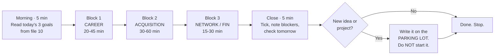

# 11 — Daily Three-Goals Tracker

Everything here is also in the printable pack (`print/BAGGA_PRINT_PACK.pdf`). Print the **Daily Card** (one per day, or laminate it and use a dry-erase marker), the **Weekly Review** (one per Sunday) and the **Dashboard** (tape it to the wall and update it Sundays).

---

## 1. The daily loop



**If the day collapses to 30 minutes:** do Goal 3's follow-ups only. Relationships are the only thing that decays irreversibly (`positioning-system/00` §Playbook).

## 2. Daily card

```text
┌──────────────────────────────────────────────────────────────────────┐
│ DAY ___ / 90      DATE ___________      ENERGY  1  2  3  4  5          │
├──────────────────────────────────────────────────────────────────────┤
│ ☐ 1 CAREER / INCOME                                    ⏱ ____ min     │
│   Action:  _________________________________________________________ │
│   Done when: _______________________________________________________ │
├──────────────────────────────────────────────────────────────────────┤
│ ☐ 2 ACQUISITION INTELLIGENCE                           ⏱ ____ min     │
│   Action:  _________________________________________________________ │
│   Done when: _______________________________________________________ │
├──────────────────────────────────────────────────────────────────────┤
│ ☐ 3 NETWORK / FINANCIAL FOUNDATION                     ⏱ ____ min     │
│   Action:  _________________________________________________________ │
│   Done when: _______________________________________________________ │
├──────────────────────────────────────────────────────────────────────┤
│ Score today:  0  1  2  3      Blocker: ________________________________ │
│ 🔒 Anything today that needs counsel?  ☐ No  ☐ Yes → added to list   │
│ Parking lot (ideas NOT started): ______________________________________ │
└──────────────────────────────────────────────────────────────────────┘
```

## 3. Weekly scorecard (Sunday, 25 min)

| Metric | Target / week | Mon | Tue | Wed | Thu | Fri | Sat | Sun | Total | Score (0-2) |
|---|---|---|---|---|---|---|---|---|---|---|
| Goals completed | 21 of 21 | | | | | | | | | ≥18 = 2 · 14-17 = 1 · <14 = 0 |
| Focused minutes | 500+ | | | | | | | | | ≥500 = 2 · 350-499 = 1 |
| New contacts logged | 2 | | | | | | | | | 2 = 2 · 1 = 1 |
| Follow-ups sent on time | 100% | | | | | | | | | 100% = 2 · ≥75% = 1 |
| Conversations held/requested | 1 | | | | | | | | | ≥1 = 2 |
| Case study completed | 1 | | | | | | | | | 1 = 2 |
| Target rows added | per file 10 | | | | | | | | | met = 2 · ≥half = 1 |
| Counsel-gate breaches | **0** | | | | | | | | | 0 = 2 · any = **0 and fix** |
| Sleep ≥7h nights | 6 of 7 | | | | | | | | | ≥6 = 2 · 4-5 = 1 |
| Protected time with spouse | ≥1 block | | | | | | | | | yes = 2 |
| **WEEK SCORE** | **/20** | | | | | | | | | **16+ green · 12-15 amber · <12 red** |

## 4. Weekly review — 8 questions (Sunday)

1. Did I do exactly three goals each day? Where did I add a fourth?
2. Which goal did I avoid, and why?
3. What did I learn that changes the thesis (fire vs pest, price, operator)?
4. Which relationship moved forward? Which went cold?
5. Did anything touch the 🔒 line? Is it on the counsel list?
6. Risk register: did any score change? (file 12)
7. Money: are we on track for the reserve bucket? (file 14)
8. What will I **stop** doing next week?

## 5. Progress dashboard (update Sundays)

```text
                         TARGET  W1 W2 W3 W4 W5 W6 W7 W8 W9 W10 W11 W12 W13
 Target list rows          100   __ __ __ __ __ __ __ __ __ __  __  __  __
 Case studies done          13   __ __ __ __ __ __ __ __ __ __  __  __  __
 Contacts in CRM            30   __ __ __ __ __ __ __ __ __ __  __  __  __
 Conversations held         10   __ __ __ __ __ __ __ __ __ __  __  __  __
 Operator candidates        10   __ __ __ __ __ __ __ __ __ __  __  __  __
 App packets queued         10   __ __ __ __ __ __ __ __ __ __  __  __  __
 Interview answers ready    12   __ __ __ __ __ __ __ __ __ __  __  __  __
 Reserve % of goal         —     __ __ __ __ __ __ __ __ __ __  __  __  __
 Weekly score (/20)         16+  __ __ __ __ __ __ __ __ __ __  __  __  __
```

## 6. 90-day milestones

| ☐ | Day | Milestone | Evidence |
|---|---:|---|---|
| ☐ | 7 | Counsel consult requested; résumé corrected; 25 target rows | Emails, résumé file, sheet |
| ☐ | 14 | 40 rows; cases 1-2; code cheat sheet | Files |
| ☐ | 21 | Counsel consult held; LBO rebuild started; 10 CRM contacts | Written answers |
| ☐ | 30 | Phase-1 review: 60 rows · 4 cases · 3 résumé variants · 3 requests | Review page |
| ☐ | 43 | **Industry locked** (fire or pest) | Decision memo |
| ☐ | 60 | Phase-2 review: 8 conversations · 8 cases · 5 operator candidates | Review page |
| ☐ | 75 | 10 packets queued · operator pipeline 10 · 15 requests | Folder, CRM |
| ☐ | 90 | 90-day review · thesis memo final · 100 rows · 13 cases | Memo PDF |

## 7. Stop-doing list (post it where you work)

```text
 ✋ STOP …                                         ➜ INSTEAD …
 ─────────────────────────────────────────────────────────────────────
 Starting a 4th goal in a day                      Park it. Tomorrow's list.
 Researching a new industry "just to check"        One alternate only (pest).
 Building tools/automation before using them       Use the sheet you have.
 Reading without a deliverable                     Every read → 3 bullets.
 Cold outreach asking for jobs                     Ask about their judgment.
 Quoting numbers without a source                  "n/d" or S-xx, always.
 Saying "authorised to work"                        Approved phrasing only.
 Doing "sample work" for a firm                    🔒 Counsel first.
 Late-night sessions that cost sleep               Stop at the 3rd tick.
 Using reserves for deal costs                     Deal fund only, capped.
 Talking about $25m                                Talk about the next 90 days.
```

## 8. Parking lot (ideas you are NOT starting)

| Date | Idea | Revisit on (Sunday) | Decision |
|---|---|---|---|
| | | | |
| | | | |
| | | | |
