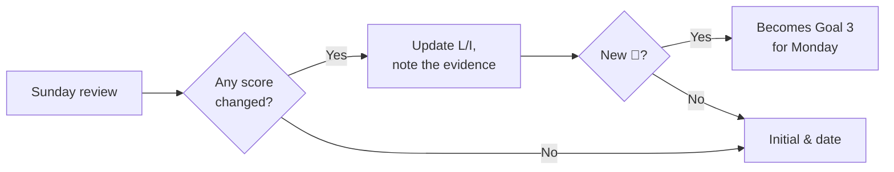

# 12 — Risk Register

**Date:** 2026-11-09 · Review every Sunday in the weekly review (file 11). Likelihood (L) and Impact (I) scored 1-5; **Score = L × I**. 🔴 ≥15 · 🟠 8-14 · 🟢 ≤7.

## 1. Heat map

```text
            IMPACT →
            1     2     3     4     5
 L   5  │     │     │     │ R04 │ R01 │
 I   4  │     │     │ R12 │ R05 │ R02 R03 │
 K   3  │     │ R16 │ R10 R11│ R06 R07 R08│ R09 │
 E   2  │     │     │ R14 │ R13 R15│ R17 │
 L   1  │     │     │     │     │ R18 │
 Y
```

## 2. Register

| ID | Risk | Category | L | I | Score | Early warning sign | Mitigation | Owner |
|---|---|---|---:|---:|---:|---|---|---|
| R01 | **Acting before counsel clears an activity** (fees, equity, officer role, LOI) jeopardises adjustment of status | Legal / immigration | 5 | 5 | 🔴25 | "Why don't you take a look at this deal for us?" | 🔒 rule; written counsel answers (08 §5); log every grey-area request | You |
| R02 | **No operator partner** found who is credible, licensed and committed | Execution | 4 | 5 | 🔴20 | 0 qualified operator conversations by Day 75 | Operator pipeline from Day 20; target recently-acquired companies' managers | You |
| R03 | **SBA closed** (citizenship rule) → financing harder, more equity needed | Financing | 4 | 5 | 🔴20 | Lenders ask about SBA eligibility | Model is non-SBA by design; target smaller deals; seller paper; patient equity | You |
| R04 | **Distraction / too many projects** | Personal execution | 5 | 4 | 🔴20 | >3 goals in a day; skipped weekly review | Daily-3 system; stop-doing list (11); one industry only | You |
| R05 | **Overpaying** against funded consolidators | Valuation | 4 | 4 | 🔴16 | Bids above 6.0x for sub-$1.5m EBITDA | Written walk-away price; IC rules (01 §7) | IC |
| R06 | **Licence-holder / key-tech departure** after close (Downside: min DSCR 0.93x) | Operations | 3 | 4 | 🟠12 | Certified #2 non-committal in diligence | Licence-transfer closing condition; retention bonuses; seller consulting | Operator |
| R07 | **EBITDA overstated** (add-backs, cash revenue) | Diligence | 3 | 4 | 🟠12 | Add-backs > 20% of EBITDA; tax returns ≠ P&L | Independent QoE; bank-statement proof of cash | You |
| R08 | **Leverage too high** — Year-3 seller-note amortisation squeezes DSCR | Capital structure | 3 | 4 | 🟠12 | Base min DSCR < 1.30x | 3 yrs IO on seller note; springing standby; senior ≤ 2.0x | You |
| R09 | **PFAS / AFFF liability** at target | Environmental | 3 | 5 | 🔴15 | Foam inventory, suppression testing history | Asset purchase (counsel); Phase I where relevant; specific indemnity + escrow; insurance history (X4) | Counsel |
| R10 | **Technician shortage** limits growth and raises wages | Labour | 3 | 3 | 🟠9 | Open tech roles > 60 days | Apprentice ladder; retention equity pool; pay benchmarking | Operator |
| R11 | **Consolidator competition** for targets | Market | 3 | 3 | 🟠9 | Owners already approached by Pye-Barker/Summit/APi | Proprietary, relationship-led sourcing; offer continuity and legacy | You |
| R12 | **EAD gap** at renewal (18-month validity, no auto-extension) interrupts job/board role | Immigration | 4 | 3 | 🟠12 | Renewal not filed 180 days before expiry | Calendar renewal on day 1 of each EAD; counsel AQ7 | You |
| R13 | **Household runway** depleted before income starts | Personal finance | 2 | 4 | 🟠8 | Reserves < 6 months | Joint plan (14); no deal costs from reserves | Both |
| R14 | **Wrong industry** — fire vs pest tie flips in field test | Strategy | 2 | 3 | 🟢6 | Field interviews favour pest (Days 38-43) | Explicit re-test; switch before seller outreach | IC |
| R15 | **Marriage / health strain** from overwork | Non-negotiable | 2 | 4 | 🟠8 | Weekly review skipped; sleep < 7h; no shared time | 60-120 min/day cap on minimum days; Sunday is protected | Both |
| R16 | **Reputation damage** from a misstatement (résumé, title, status) in a small market | Reputation | 3 | 2 | 🟢6 | Any unsourced claim in outreach | Résumé corrections (R-01); verification rule | You |
| R17 | **Securities-law misstep** raising investor money | Legal | 2 | 5 | 🟠10 | Informal "invest with me" talk | Securities counsel before any capital conversation framed as an offer | Counsel |
| R18 | **Single-business concentration** of household wealth | Non-negotiable | 1 | 5 | 🟢5 | Personal guarantee > liquid net worth | Never guarantee beyond agreed cap; keep investments separate from the business | Both |

## 3. Top-3 risks (IC view)

1. **R01 — Immigration missteps.** Irreversible. Everything else can be fixed.
2. **R02 — No operator.** Your model is impossible without one.
3. **R05/R08 — Paying too much with too much debt.** The Zips and Encompass lesson (file 04).

## 4. Review protocol


