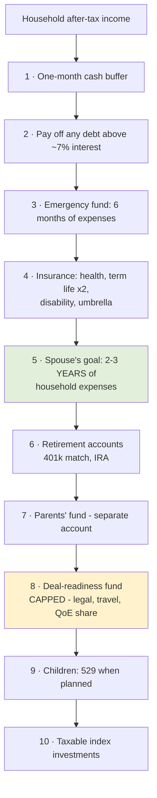

# 14 — Joint Financial Plan (Brief §11)

**Date:** 2026-11-09 · Numbers are planning arithmetic, not advice. Live calculator: `06_FIRST_ACQUISITION_MODEL.xlsx` → *Household_Goals*. Fill in your real income and spending before acting.

> Not in the brief's file list, but §11 needed a home. It sits alongside 01-13 and changes none of them.

---

## 1. Five things that are NOT the same number

```text
 BUSINESS ENTERPRISE VALUE   $8.8m   Base-case exit EV (file 06) — belongs to ALL holders, before debt
   − debt, costs              ≈ −$0.3m
 = EQUITY VALUE               $8.5m   Split among investors, seller, operator, you
   × your share (fee + promote)
 = YOUR PERSONAL NET WORTH    ≈ $1.2m from this deal (pre-tax) — illiquid until exit
   of which LIQUID            $0 until a sale or recap
 OWNER DISTRIBUTIONS          Cash actually paid out; $0 in the model (cash retained to repay debt)
 PRE-TAX vs AFTER-TAX         Fees = ordinary income; carry may get capital-gains treatment
                              only if holding-period rules are met (tax counsel)
```

**Rule:** household safety is measured in **liquid, after-tax dollars only**. Enterprise value on a slide never pays rent.

## 2. The savings waterfall — fill in this order



**Why the deal fund comes 8th:** your non-negotiables are financial safety and no dependence on one business. Deal capital comes only from surplus, never from reserves. In the model you contribute **$0 cash** to the first acquisition.

## 3. Capital needed for different spending levels

| Household spend / yr (after tax) | 2-yr reserve | 3-yr reserve | FI @ 3.9% (30-yr) | FI @ 3.5% (35-yr) | FI @ 3.0% (50+ yr, A) |
|---:|---:|---:|---:|---:|---:|
| $60,000 | $120,000 | $180,000 | $1.54m | $1.71m | $2.00m |
| $80,000 | $160,000 | $240,000 | $2.05m | $2.29m | $2.67m |
| $100,000 | $200,000 | $300,000 | $2.56m | $2.86m | $3.33m |
| $150,000 | $300,000 | $450,000 | $3.85m | $4.29m | $5.00m |
| $250,000 | $500,000 | $750,000 | $6.41m | $7.14m | $8.33m |
| $500,000 | $1.0m | $1.5m | $12.8m | $14.3m | $16.7m |

SWR sources: Morningstar 3.9% for 30 years and 3.5% for 35 years at 90% success (S-38). **Retiring at 30 means a 50-60-year horizon**, so 3.0% is the planning assumption — and it's an assumption.

### Spouse's goal: months to reach a 2-3-year reserve

| Target | 24 months | 36 months | 48 months |
|---|---:|---:|---:|
| $120k (2 yrs at $60k) | $5,000/mo | $3,333/mo | $2,500/mo |
| $180k (3 yrs at $60k) | $7,500/mo | $5,000/mo | $3,750/mo |
| $240k (3 yrs at $80k) | $10,000/mo | $6,667/mo | $5,000/mo |

(Simple division; ignores returns. Hold in high-yield savings / Treasury bills, not stocks.)

## 4. Challenging the $25M and $3M goals

From the *Household_Goals* sheet (assumptions in yellow, all changeable):

| Assumption | Value |
|---|---|
| Your ownership of portfolio equity | 25% |
| Portfolio EV / EBITDA | 7.0x |
| Portfolio net debt / EBITDA | 2.5x |
| Share of EBITDA paid out to equity after debt service, capex, tax | 40% |

| Goal | What it requires |
|---|---|
| **$3m/yr pre-tax personal income** | Portfolio EBITDA of **~$30m** (≈ $210m enterprise value) — about **12 median search-fund-sized companies** at ~$2.5m EBITDA each (S-29) |
| **$25m personal net worth** | Portfolio EBITDA of **~$22m** at 25% ownership |
| One Base-case deal (file 06) | ≈ **$1.6m pre-tax** to you over 5 years → **~16 Base-deal-equivalents** for $25m before reinvestment |

### The IC's honest view

```text
 Goal                         By 33?                 By 40-45?
 ─────────────────────────────────────────────────────────────────
 2-3 yrs household reserve    ✅ Achievable           —
 Retire parents (modest)      🟡 Possible w/ 1 exit   ✅ Likely if plan works
 Financial independence @30   🔴 Unlikely             🟡 Possible
 $25m net worth               🔴 Very unlikely        🟡 Plausible w/ 3-5 good deals
 $3m/yr income                🔴 Not credible         🟡 Requires a $200m+ portfolio
```

**What a strong but realistic path looks like by 33 (illustrative, not a forecast):** a role in M&A from ~2027; deal #1 closes ~2029-30 as co-sponsor or lead; one exit or recap by ~2034-35. Using the model's range, deal #1 is worth **~$0.5m (Conservative) to ~$3.5m (Aggressive)** pre-tax to you. Personal net worth at 33 in the **low single-digit millions** would be an excellent outcome.

**Better goals (proposed):**
1. **Safety goal (age 26):** 2-3 years of expenses liquid + insurance + wills. *Spouse's goal — done first.*
2. **Platform goal (age 30):** one acquired company with a strong operator, DSCR > 1.5x, you on the board.
3. **Freedom goal (age 35):** liquid, after-tax portfolio ≥ 25-30× annual household spend *(e.g., $2.4m at $80k/yr)*.
4. **Ambition goal (age 40-45):** holding company with 3-5 businesses; $25m becomes a reasonable target.

## 5. Protection checklist

| ☐ | Item | Why / note |
|---|---|---|
| ☐ | Term life insurance — both spouses | Income replacement; cheaper at 23 |
| ☐ | Long-term disability (own-occupation if possible) | Your earning power is the main asset |
| ☐ | Umbrella liability policy | Before any business ownership |
| ☐ | Wills, durable powers of attorney, healthcare directives | Both spouses |
| ☐ | Beneficiary designations on every account | Override wills |
| ☐ | **Estate attorney question:** a bequest from a U.S.-citizen spouse to a **non-citizen** spouse does not get the usual unlimited marital deduction without a QDOT (verify — IRC §2056(d)) | Relevant until you naturalise |
| ☐ | Key-person insurance on the operator (company-level, at acquisition) | File 07 |
| ☐ | Cross-border tax adviser before any move abroad | File 08 §6; S-39 |

## 6. Parents' fund

Treat it as a **named, dated goal** with its own account: "Parents' home — $____ by year ____" and "Parents' annual support — $____/yr from year ____". Fund it after the household's 2-3-year reserve; never from deal capital. Revisit the numbers once your income starts.

## 7. Monthly money meeting (30 min, first Sunday) — agenda

1. Net worth snapshot: **liquid / retirement / illiquid** columns, kept separate.
2. Waterfall: which bucket are we filling? On track?
3. One decision only.
4. Anything that touches immigration or a guarantee → counsel list.
